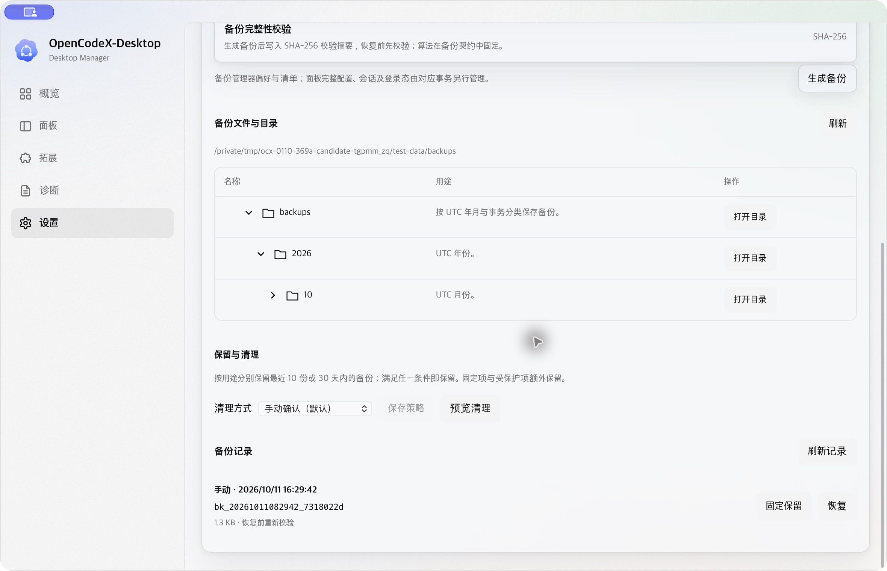

# 369ab12d macOS 同根退出与重启证据

源码：main@369ab12da55448fbfdc4d0c9bf03970b56fd6c27。使用 DMG 复制安装后的隔离 ad hoc 测试副本；原件正式签名 / 公证门禁仍未通过。结论仅为隔离同根生命周期局部通过，不能关闭原生、安装升级、性能或发布门禁。

| 观察 | 独立证据 | 结果 |
|---|---|---|
| 17:37:30（UTC+8）退出前 | before-quit.json | PID9422、正确 test-data 根，锁占用 |
| 原生 ⌘Q 后 17:37:47 | after-quit.json | 测试进程消失，非阻塞独占锁可取得；未删除 / 截断锁文件 |
| 17:37:58 UI 工具自动重开 | after-ui-observation.json、after-quit.ax.txt | PID96522 使用旧 /tmp/ocx-0110-dmg-install-tuk3m7/data；此尝试失败，不计同根重启 |
| 再退出后 17:38:36 | relaunch-after-quit.json | 测试进程消失、锁可取得 |
| 17:38:37 显式同根启动 | restart-receipt.json、after-explicit-restart.json | open exit 0；PID97688，环境、根、内嵌 SHA、锁 metadata 匹配 |
| 原生设置回读及 17:49:14 复核 | after-explicit-restart-backup.ax.txt、final-lifecycle.json | 根 / 年展开、月份收起，原备份记录可见；唯一测试实例保持正确根与锁 |

退出前、退出后、显式重启后和最终快照中，bk_20261011082942_7318022d 的 preferences.json（1371 bytes，SHA256 58e1c8cc33f43243cd1dee8db4a45da712106e44c29c1ad6a0f97288843e3c85）及 backup-manifest.json（562 bytes，SHA256 681b0333bcc6858eb6c52212a6de819548871a58c221e85809c70e59ff38287d）完全一致。日常 PID75764 及 Oct9 22:00:24 启动时间不变。只保存摘要，没有备份偏好载荷。

三份截图原文件名为 .png，实际 magic 为 JPEG；归档仅改扩展名为 .jpg，字节保持不变，逐文件映射见 provenance.json。保留所有误操作 / 失败观察；退出证明只依据 after-quit.json，不能使用触发了自动重开的 after-quit.ax.txt。后续应先从进程快照观察退出，再显式带隔离环境重启并验证后读取 UI。

没有执行恢复、清理、固定、升级、默认根迁移、日常安装替换或公开发布。release_authorized: false、release_accepted: false。
