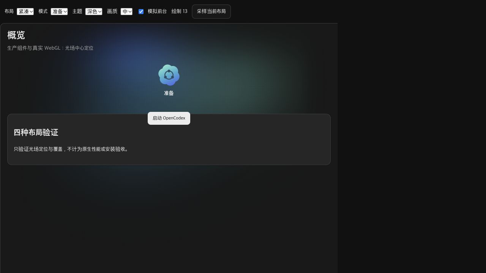

# c1e3c09d 背景光移层后的中心定位

源码 main@c1e3c09d8ed33238543ce5943e439991b8099088，前序基线 369ab12da55448fbfdc4d0c9bf03970b56fd6c27。仅确认概览光场的布局定位与绘制生命周期；不认定此前 CPU 差值原因或性能门禁通过。

光层 Teleport 到页面后，旧相邻节点查找找不到原处的 Logo，回落到固定比例。现在显式传入 Logo 元素，复用一个 ResizeObserver 观察光层和 Logo；连续动画帧不读几何，销毁断开观察器，后台仍受 active 限制。未改 shader、画质、DPR 或绘图缓冲策略。

| 检查 | 结果 / 证据 |
|---|---|
| 修复前有效回归基线 | baseline-active-test.log：5 fail / 1 pass；使用 active:true |
| 首次无效测试夹具 | baseline-test.log：6 fail；漏传 active:true，不能作为产品基线 |
| 相关回归 | targeted-test.log：4 文件 / 39 项通过 |
| 完整 UI 回归 | full-ui-test.log：95 文件 / 472 项通过 |
| 最终新测试复核 | targeted-final-test.log：6 项通过；测试 mock 类型修正之后 |
| 类型 / 构建 | typecheck-build.log 首次仅新测试 mock 类型失败；typecheck-build-final.log 修正后 exit 0，170 模块 |
| 真实 WebGL 静态布局 | browser-matrix-final.json：标准 / 紧凑 × 就绪 / 准备 × 浅 / 深 8 项，中心误差 0 CSSpx |
| 页边覆盖 | 同矩阵顶部、左侧覆盖 true，无水平溢出，Teleport true，DPR 2、drawing buffer 1421 × 1342 |
| 高画质前台 / 后台 | browser-high-lifecycle.json：draws 40 → 1140，后台 1160 保持约 15.55 秒，恢复 1216 |
| 浏览器错误 | browser-console.json：error / warn 空 |

生产组件、Pinia、样式和真实 WebGL 在独立临时夹具中执行。QA 包装只记录实际 u_cy 与绘制次数，没有替换 renderer / shader。后台通过夹具前台状态控件切换，不能代替原生焦点、CPU 或物理 DPI。高档 Logo 动画 transform 造成瞬时 DOM 中心偏移；该数据不用于静态中心断言，光场使用布局锚点避免逐帧几何读取。

首次浏览器遍历快于 250ms 报告轮询，紧凑就绪报告陈旧；browser-first-attempt-stale.json 与 screenshots/stale-attempt/ 保留，整组不计通过。最终 sample 控件等待 nextTick 与两次 RAF 后重采，只有 final 矩阵及 screenshots/final/ 计入有效证据。

QA 3 个源文件保留在 fixture-final/，原临时 Vite 已停止、后台 QA tab 已关闭，代码树中临时源已移除。日志原字节 gzip 与清理后的阅读视图分别保留；provenance.json 记录原始大小 / 摘要，checksums.json 覆盖其他归档文件。无安装器、真实偏好或用户数据载荷。

旧 369a 候选不含此修复，需要同一 c1e3 源码的 CI 与双平台新候选。CPU / RSS 配对、冷 / 热启动、主线程 / 零请求、真实周期、Windows 双权限 / 物理 DPI / 默认根 / 原生外观、真实更新 / 事件及正式签名继续待验。IMP / TASK 保持 in_progress，release_authorized: false、release_accepted: false。
