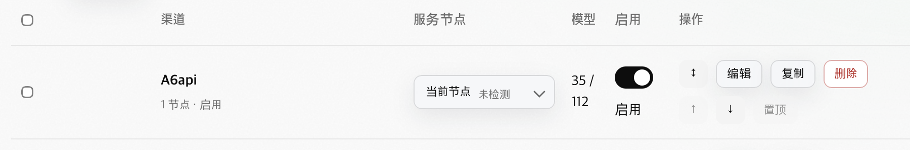
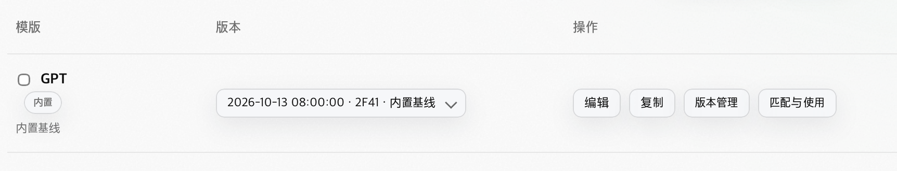
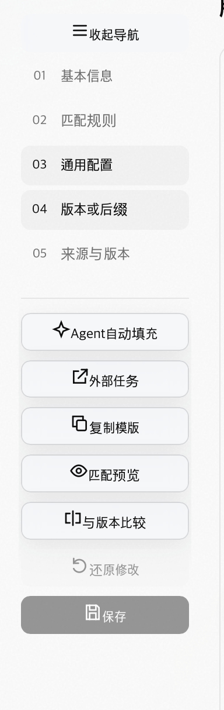
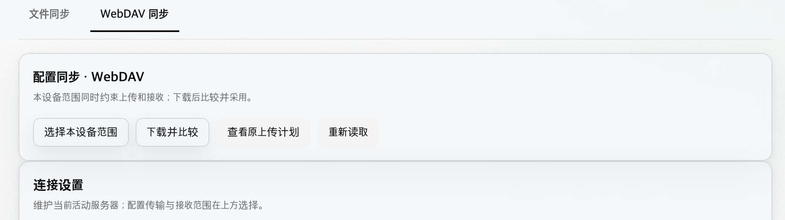
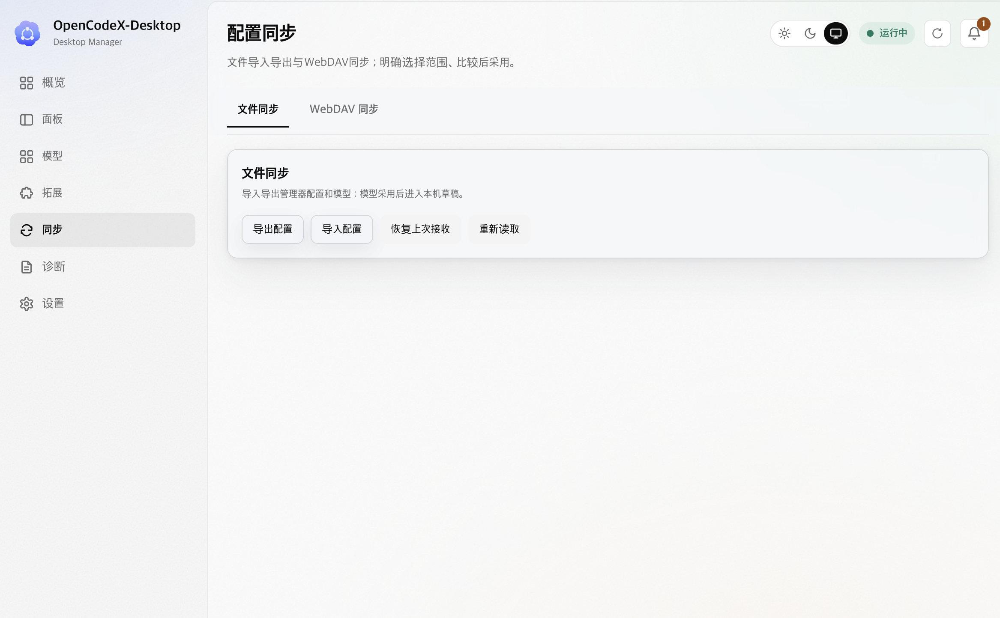
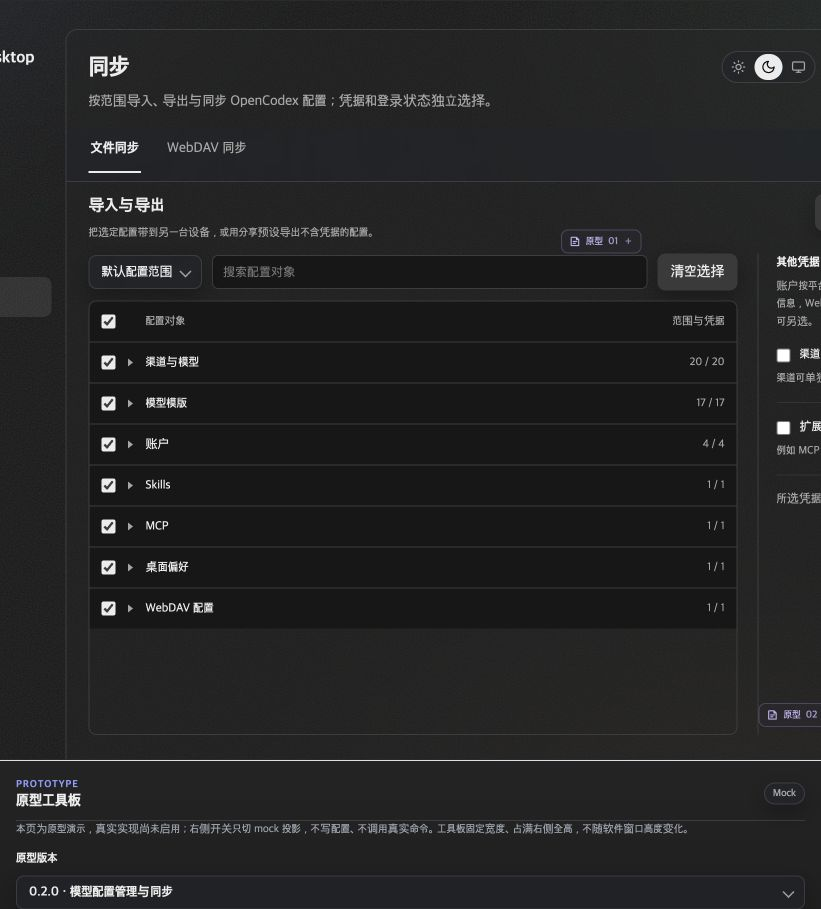
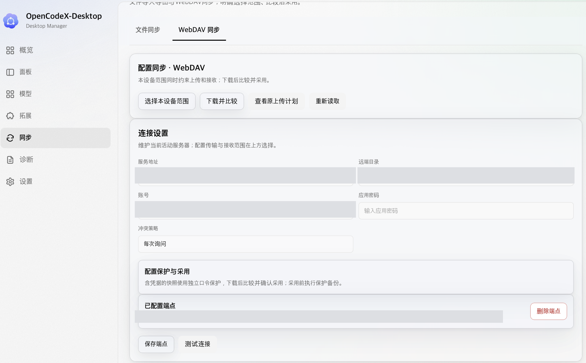
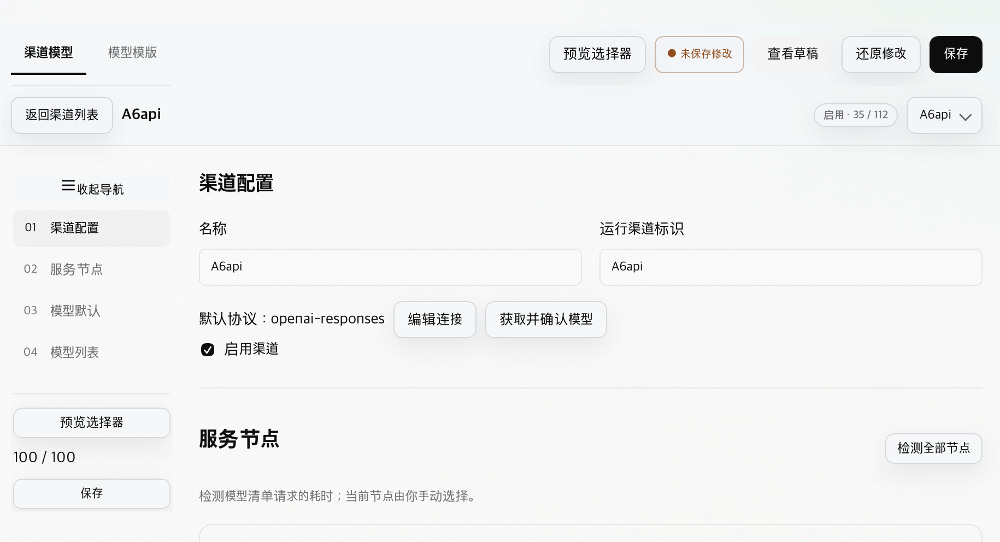
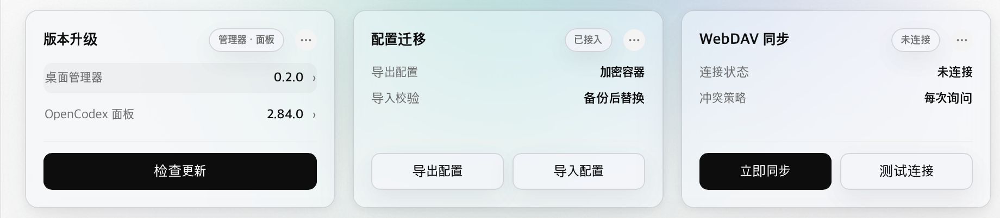

# 0.2.1 UI问题清单

创建日期：2026-10-21（Asia/Shanghai）。

状态：收集中，修复文档计划已编制，尚未开始软件修复。用户逐条提出问题及本轮主动对照发现集中追加。

基线：[0.2.0 stable](https://github.com/gzers/opencodex-desktop/releases/tag/v0.2.0)，main/tag源码为f1bbe7d996389097dcf6237a6bc65b7995d68190；发布证据见[REL-11](../../../../../03-开发实施/REL-OPENCODEX-DESKTOP-11.md)。软件UI修复拟集中随0.2.1交付，具体范围以收集后的修复安排为准；仅改原型或文档不单独触发软件发版。

主动对照：[0.2.0与原型系统对照审计](20261021-0.2.0与原型系统对照审计.md)，首轮覆盖七个主入口与重点子流程；新增UI-007～UI-014，未宣称全部状态检查完毕。

计划入口：[IMP-22公共UI收敛与原型还原修复](../../../../../03-开发实施/IMP-OPENCODEX-DESKTOP-22.md)，逐项关闭条件见[0.2.1验收矩阵](../03-测试验收/0.2.1-UI修复验收矩阵.md)。公共封装完整性、采用守卫及验证先于页面局部修补；当前15项均未实施，不因写完计划自动关闭。

## 记录方式

- 按收到顺序编号UI-001、UI-002……，保留用户现象、期望及截图/批注来源；未提供的条件记待核实，不猜测原因。
- 区分正式软件、原型和公共组件问题；共性样式标记相关消费者，后续按影响范围修复、验证。
- 状态按待核实、待修复、已修复待验证、已验证、暂缓记录；实际修复时补实现提交及验证结果。
- 当前仅登记问题、编制修复计划与验收条件，不改应用代码、不启动新发布；0.2.0标签和公开制品保持原样。

## 问题条目

| 编号 | 页面/控件与环境 | 现象及来源 | 期望效果 | 影响范围 | 状态 | 修复与验证 |
| --- | --- | --- | --- | --- | --- | --- |
| UI-001 | 模型 → 渠道模型列表；用户截图为亮色，窗口尺寸/缩放待核实 | 复选列留白过大，其他列被挤压；模型数量折行，启用和操作布局拥挤。来源：2026-10-21用户反馈、图1 | 复选列仅占必要窄宽；渠道、服务节点、模型数量、启用和操作按内容合理分配，保持表头/行对齐 | 渠道列表列宽与窄窗/缩放；是否涉及公共表格配方待排查 | 待修复（本轮实屏复现） | 尚未实施 |
| UI-002 | 模型 → 模型模版列表；用户截图为亮色，窗口尺寸/缩放待核实 | 复选框混在模版名称列中，没有独立列；模版名称、内置标记和说明的排布拥挤。来源：同日反馈、图2 | 复选框独立窄列；模版名称、标记、说明在内容列有序排列；版本与操作保留合理宽度 | 模版列表列结构/宽度，与渠道列表的选择列规则保持一致；公共配方影响待排查 | 待修复（本轮实屏复现） | 尚未实施 |
| UI-003 | 模型 → 模版/渠道详情侧栏；截图为模版详情、亮色，窗口尺寸/缩放待核实 | 收起导航和操作按钮的图标与文字垂直错位、间距不足。用户指出渠道详情也有同类问题 | 图文垂直居中，图标尺寸/间距由公共按钮配方统一，同类侧栏操作对齐一致；收起态仍居中且可读 | UiButton内容层、DetailWorkspace收起控件、模版与渠道详情消费者及其他同类图文按钮 | 待修复（源码缺口与本轮渲染均确认） | 尚未实施；见下方代码核对及统一样式要求 |
| UI-004 | 同步 → WebDAV同步；用户截图为亮色，窗口尺寸/缩放待核实 | “配置同步 · WebDAV”与“连接设置”两张卡片上下贴合，没有间隔。来源：2026-10-21用户反馈及图4 | 相邻卡片保持清晰、统一的垂直间距，由页面公共布局管理 | WebDAV内容容器与卡片组合；同步页其他相邻卡片是否同类受影响待核 | 待修复（本轮实屏复现） | 尚未实施 |
| UI-005 | 同步 → 文件同步及WebDAV同步；正式截图与当前主原型对照 | 文件同步主页面完全没有范围区，也没有独立范围入口或当前范围摘要，只有操作按钮；点击导出才出现范围弹窗。WebDAV另有“选择本设备范围”入口，连接表单常驻主体 | 恢复主页面范围选择主体，所选内容及凭据参与状态外层可见；连接设置按需打开，保留必要的确认/解密弹窗 | 同步信息架构、文件导入导出与WebDAV共同范围组件；关联UI-004间距，但非同一问题 | 待修复（原型、源码及本轮实屏均确认） | 尚未实施；具体差异与流程约束见下文 |
| UI-006 | 模型 → 渠道详情；亮色截图，窗口尺寸/缩放待核实 | 应归侧栏的详情动作仍显示在顶部，预览/保存等与侧栏重复 | 按原型归位详情侧栏，列表工具栏和详情动作按上下文区分，避免重复入口 | ModelsRoute页级工具栏、渠道详情侧栏及固定栏；关联UI-003 | 待修复（本轮实屏复现） | 尚未实施 |
| UI-007 | 渠道详情→型号列表 | 搜索/筛选/排序纵向堆叠，重复名称与别名标签拉高行；本轮证据与差异见系统对照审计UI-007 | 紧凑工具栏与摘要，保留必要能力、详细编辑渐进展开 | 渠道型号工具栏、列表行配方 | 待修复（本轮确认，P1建议） | 尚未实施 |
| UI-008 | 模版详情→身份栏 | 仅名称输入与未修改，缺可见的来源/操作版本/基准与版本入口；本轮证据与差异见系统对照审计UI-008 | 详情首屏显示真实版本身份及上下文 | 详情头、版本选择与来源状态 | 待修复（本轮确认，P1建议） | 尚未实施 |
| UI-009 | 渠道详情→连接/模型默认 | 连接仅协议行和弹窗入口，默认区全量表单加17项下拉，主次与原型相反；本轮证据与差异见系统对照审计UI-009 | 摘要优先、按需编辑，敏感字段保持保护 | 渠道连接与默认配置组合 | 待修复（本轮确认，P2建议） | 尚未实施 |
| UI-010 | 模版/渠道共用规则字段 | 继承复选远离标签，缺原型字段分组及规则/来源说明；本轮证据与差异见系统对照审计UI-010 | 共用字段模式、单位、继承/未知与来源说明 | ModelRuleFields及消费者 | 待修复（本轮确认，P1建议） | 尚未实施 |
| UI-011 | 模版列表/设置→Agent配置 | 缺原型常驻入口，只能在助手/批量检查内部配置；本轮证据与差异见系统对照审计UI-011 | 补常驻入口，复用同一设置源 | 模型列表、设置分区、执行配置入口 | 待修复（本轮确认，P2建议） | 尚未实施 |
| UI-012 | 设置→通用→画质 | 高/中/低及WEBGL/CSS由分段选项变成Select；本轮证据与差异见系统对照审计UI-012 | 恢复公共分段单选及有依据的窄窗降级 | 设置画质与公共Segmented | 待修复（本轮确认，P2建议） | 尚未实施 |
| UI-013 | 模型Tab/固定栏 | 模型分隔线仅左侧Tab块，未与全宽动作区形成统一边界；本轮证据与差异见系统对照审计UI-013 | 统一Tab/动作/分隔配方，合法玻璃与低档回退 | StickyTabs、ModelsRoute及详情固定头 | 待修复（本轮确认，P2建议） | 尚未实施 |
| UI-014 | 模版详情→侧栏 | 锚点加7个动作堆叠，保存落到1180×760首屏下方；本轮证据与差异见系统对照审计UI-014 | 导航/辅助区可滚，关键保存/状态稳定可见 | DetailWorkspace侧栏与模版操作组 | 待修复（本轮确认，P2建议） | 尚未实施 |
| UI-015 | 概览→版本升级卡片；亮色、0.2.0用户截图，窗口尺寸/缩放待核 | 两行版本文字与相邻卡片内容观感不一致；悬浮背景内文字/箭头贴左右边缘，缺必要内距 | 三卡同级内容统一字号/字重/行高，可统一增大该层级；可点击信息行统一内距、对齐及hover/focus配方 | 概览状态行公共配方、UiButton plain消费者及页面局部覆盖 | 待修复（用户截图确认，已核源码；P2建议） | 尚未实施；见UI-015说明 |

### UI-001 渠道表格列宽失衡

用户原话：“模型渠道的表格列宽度分配不对，复选留了很多位置其他都挤到一起，应该合理分配宽度。”

截图可见复选框之后有大块留白，模型计数35 / 112折为两行，启用状态和操作按钮也分行。具体CSS原因及适用宽度尚未核实；修复时为选择列设置必要宽度，其他列结合内容和可用空间分配，长内容及窄窗按公共表格规则处理，像素值待实际排查确定。

原始附件：codex-clipboard-295507b4-9d2f-4c6c-8e8f-933ef7a057c3.png，原字节保存。

### UI-002 模版表格复选列与内容排布

用户原话：“模版这里反而复选没有独立列，模版列挤到一起了。”

将复选框和模版内容分列是本条期望；名称、内置标记、说明的组合排版及版本/操作列空间需一起核对。后续同时检查两张表的行内按钮尺寸、对齐与长名称表现，不凭截图推定已验证其他主题或缩放条件。

原始附件：codex-clipboard-287b8534-70f6-4fae-92c6-1d7f1ca547a3.png，原字节保存。

### UI-003 详情侧栏按钮图文错位与公共样式缺口

用户反馈：“模版和渠道详情侧边栏按钮图标都文字和图标不对齐”，并要求正式开发代码具备与原型组件相对应的统一样式。截图可见收起导航、Agent自动填充、外部任务、复制、预览、比较、还原、保存等图标与文字错位。渠道详情同类问题来自用户陈述，本次附件为模版详情；未用一张图宣称全部消费者已复现。

原始附件：codex-clipboard-d0b3b3b9-bfe5-453a-bc64-4493b5583848.png，原字节保存。

2026-10-21只读代码核对，源码main/tag f1bbe7d996389097dcf6237a6bc65b7995d68190：

- 全局入口main.ts实际导入styles/tokens.css、base.css、materials.css，已有字体/颜色/间距/控件尺寸Token、公共按钮配方和亮暗/三档材质，正式DEV gallery引用生产组件。已有底座，但不能据此断言所有组合正确。
- components/ui/UiButton.vue将默认插槽包在btn-content内。base.css定义按钮高度/字号/内距/状态，却没有定义btn-content的图文排列、居中和gap；其现有公共规则仅处理loading时透明度。图标和文字在普通行内内容中可能按基线排列，这是与本截图一致的源码缺口，具体渲染偏差仍需现场核对。
- routes/ModelsRoute.vue的model-editor-action只设置按钮全宽及SVG的16px/描边等；components/layout/DetailWorkspace.vue收起导航也将SVG和文字直接放进UiButton。仅在按钮外层指定justify-content或图标flex:none不能为内部行内内容建立居中布局。
- 公共样式约束tests/component-style-rules.test.ts目前检查公共组件内的颜色、字号、字重和层级常量；没有检查图文几何对齐，也不覆盖全部业务局部样式。已有检查通过不能证明本组合无问题。

以上为源码核对，不是修复完成；未修改应用代码。正式实现定位：apps/desktop/ui/src/components/ui/UiButton.vue、components/layout/DetailWorkspace.vue、routes/ModelsRoute.vue、features/models/ChannelEditor.vue、styles/base.css。

### UI-004 WebDAV相邻卡片缺少间隔

用户原话：“同步这里卡片都连到一起了。没有间隔。”

截图显示WebDAV同步Tab下，“配置同步 · WebDAV”卡片底边与“连接设置”卡片顶边紧贴。期望由页面的公共纵向布局统一管理卡片间距，避免各卡片独立补margin造成重复或遗漏；具体间距沿已有规范和实际布局核对后确定。

原始附件：codex-clipboard-992a33a7-0ca8-4d1c-b5af-c8ce20fa75fc.png，原字节保存。页面归属按用户说明和截图中的同步Tab判定；附带浏览器环境URL为扩展原型页，不能据此推定截图属于该页面。尚未定位CSS原因或验证其他尺寸/主题。

### UI-005 同步范围从主页面移入弹窗，偏离原型主体流程

用户反馈：“文件同步这里跟原型差异太大。本来是最外层或者要有范围，现在完全没有或者收到弹窗，分析再记。”本条按附图和代码将“收到弹窗”理解为范围被收进弹窗。

#### 实际对照结论

2026-10-21使用design-studio设计QA流程读取唯一主原型的文件同步页DOM并保存截图；同时只读核对正式源码f1bbe7d996389097dcf6237a6bc65b7995d68190。用户随后明确指出“文件同步是完全没看到吧”：正式文件同步主页面确实完全没有范围预设、对象树、凭据区，也没有独立的范围入口或当前范围摘要。只有点击“导出配置”后弹窗才呈现这些内容。代码中存在范围能力不能用来弱化主页面完全不可见的问题；WebDAV另有“选择本设备范围”按钮，两者应分别描述。

| 对照项 | 主原型 | 正式0.2.0 | 影响 |
| --- | --- | --- | --- |
| 文件页主体 | “导入与导出”动作与同步范围预设、搜索、清空选择、类别/对象树直接呈现 | 主页面只有“文件同步”卡片与导出/导入/恢复上次接收/重新读取，完全没有范围区或范围入口 | 页面留白大，用户完全看不到可选对象、当前范围及凭据参与情况 |
| 范围选择 | 外层直接选范围，再执行导出 | 点击“导出配置”才加载目录并打开“选择配置导出范围”弹窗，再进确认清单 | 原型的主任务内容被变成二级弹窗步骤，选择及修改范围的可见性降低 |
| 凭据选择 | 外层“其他凭据”区，与对象范围并列，参与情况可见 | 跟随范围进入弹窗，主页面没有对应展示 | 用户发起操作前无法在主页面查看范围与凭据参与状态 |
| WebDAV主体 | 当前连接摘要、连接设置入口及常驻同步范围；保存范围与同步动作可见 | “选择本设备范围”再开同源弹窗；独立连接设置大表单常驻下方 | 信息重点从配置范围转成连接维护，与原型相反；叠加UI-004卡片紧贴 |

正式源码定位：routes/SyncRoute.vue将ModelTransfer和WebDavConnection作为独立页面块；features/sync/ModelTransfer.vue主article只有动作入口，begin()设置selectionOpen=true，ObjectScopeTree/预设/凭据均在对应UiDialog内；prepare()关闭该范围窗再显示确认清单。WebDavConnection.vue将连接字段直接渲染为常驻article。可以确认是实现结构偏差，不能仅通过补gap或改按钮尺寸解决。

原型入口：[主原型文件同步页](../../../../01-项目支撑资料/01-产品原型/原型/index.html?design=sync#sync?tab=file)，WebDAV对应#sync?tab=webdav。当前DOM读取包含“同步范围”、预设、对象搜索、清空选择、渠道/模版/账户/Skills/MCP/桌面偏好/WebDAV配置及“其他凭据”；对象计数仅是mock样例，不作为正式目录要求。

#### 修复方向及必须保留的边界

- 作为原型还原缺陷安排：把共同范围选择器、预设/搜索/对象树和凭据参与区放回两个Tab的主页面，布局按原型及公共组件规范；不另建第二份范围状态或格式服务。
- 文件导出以外层当前范围准备冻结清单；预览、敏感材料保护、错误、生成和结果仍按真实事务执行。导入读取文件后的可采用子集来自包内内容，不把页面导出范围当作导入授权或据此清除包外本机对象。
- WebDAV外层展示并编辑本设备范围，区分未保存范围、已保存尚未传输、下载待审及实际采用；连接信息呈摘要并通过“连接设置”按需维护，避免连接大表单代替范围主体。
- 不要求取消所有弹窗：连接编辑、导入文件读取/必要解密、依赖/差异确认与风险确认仍按其职责保留。当前原型要求的是范围主体外置。
- 保留已确认账户范围：仅受支持平台/来源的信息同步，新设备需登录。同步旧方案里的登录迁移描述已由2026-10-20用户确认调整，本次还原不恢复旧登录态承诺。
- 后续验收必须直接比较正式主页面与原型的内容层级和操作顺序，再验证实际范围/依赖/凭据/事务。此前范围弹窗内功能通过的证据不能作为主页面结构还原通过；本条明确记录这一遗漏。

#### 输入与对照截图

来源：用户附件codex-clipboard-44b7cd5a-06d6-4c42-a38b-189073902ce1.png，原字节保存。

来源：2026-10-21实际打开的主原型文件同步页，包含原型工具板，不是正式软件功能证据。

来源：用户附件codex-clipboard-e9e81ccf-4c31-40a2-a80c-435516f80a12.png。入库副本遮蔽服务器地址、远端目录、账号及凭据引用后已目检，原始未脱敏图片不复制进仓库。此图支持同源WebDAV结构分析，卡片紧贴另沿UI-004跟踪。

当前只完成对照分析与登记，未修改正式软件或原型。

### UI-006 渠道详情动作未归位侧栏，顶部与侧栏重复

用户原话：“还有渠道模型详情按钮应该是侧边栏的放到顶部。”结合本轮原型对照和截图，记录为应归侧栏的详情动作仍出现在顶部。

截图顶部显示“预览选择器、未保存修改、查看草稿、还原修改、保存”，侧栏又有“预览选择器、100 / 100、保存”，存在同类动作重复和详情操作归属不一致。期望渠道详情沿原型在侧栏组织相应动作与保存状态，顶部保留Tab及必要的返回、渠道身份/切换上下文；进入列表时的页级工具栏单独处理，不把列表工具栏原样叠加到详情。具体动作全集及状态位置修复时逐项对照原型，保持既有保存作用范围与确认语义。

来源：2026-10-21用户附件codex-clipboard-e35b0a52-43ef-437b-999e-2e5461871486.png，原字节保存。当前为截图确认，尚未执行布局修复或现场复现；关联UI-003侧栏图文对齐，共同核对展开/收起、固定栏和窄窗，但不合并编号。

## 统一样式修复要求（2026-10-21用户追加）

- 沿现有正式Token → 公共配方/控件 → 布局 → 业务消费者的分层补齐样式；原型与正式gallery有对应关系，gallery继续直接展示生产组件。
- 图文按钮的图标槽位、尺寸、间距、垂直居中、文字行高、loading/disabled布局由公共层负责。同类用途统一内容对齐；纯图标按钮沿专用规格，不让各页面手写偏移量补救。
- UI-003修复应检查全部相关图文按钮使用方，并保留有明确用途的配方差异；UI-001/002的复选列与表格列分配也按统一规则收敛，不机械给所有业务表格同一比例。
- 后续修复记录必须给出受影响消费者的实际渲染结果，覆盖适用尺寸、展开/收起、长文案、亮暗/材质和缩放边界；源码扫描、登记数量或单测通过不能替代图文对齐的实屏核对。
- 新增组合或发现既有缺口时，先补公共规格及真实组件样例，再由业务采用；本轮先登记，后续集中安排0.2.1实施。

## 2026-10-21主动对照补充

UI-001～UI-006均已在独立0.2.0发布副本复现；前文“尚未现场复现”是用户初次登记时状态，本段与表格为当前核实状态。UI-001/002分别见本轮04/08号；UI-003见10/33；UI-004见17；UI-005见14～18；UI-006见05/07。新增八项的逐条描述、优先级、整改顺序、截图及证据边界统一放在[系统对照审计](20261021-0.2.0与原型系统对照审计.md)，本清单仍是唯一问题编号入口。

当前升级卡片未复现旧白底问题；扩展外卡片和上间距保留；Tab固定栏已见模糊，不能笼统说全都仍不透明。未检查的状态不以本轮抽样宣布通过。当前没有软件修复提交。

## UI-015 概览版本行的文字规格与悬浮内距（用户追加）

2026-10-21用户反馈：“版本升级的两行和另外的卡片文字大小不一致，要么都增大。而且鼠标浮于上方的时候选中背景无边距”。此处为hover悬浮反馈，不是持久选中状态；缺口主要是文字/箭头到悬浮背景边缘的**左右内边距**，不能误改卡片外边距。

来源：用户原始附件codex-clipboard-e23d8294-7e6e-4a81-8db1-adc13b3db9b2.png，按原字节保存并核对SHA-256。截图显示版本升级两行为可点击行，桌面管理器行悬浮底色内的标签和箭头几乎贴边；相邻“配置迁移”“WebDAV同步”为普通信息行。用户报告的字号观感差异记为待统一事项，未读取此截图对应窗口的computed style，不能仅凭观感宣称实际字号相差多少像素。

### 只读源码核对

正式main f1bbe7d996389097dcf6237a6bc65b7995d68190：

- routes/OverviewRoute.vue 312～313行，版本两行已复用UiButton（ghost / plain / sm）；并非完全没有采用全局组件。
- 同文件440～442行，页面overview-update-row局部样式设为display:block、width:100%、padding:var(--space-1) 0、font:inherit；内容层单独设flex与baseline。**水平padding明确为0，覆盖公共小按钮左右内距**，与截图悬浮反馈缺少内距的现象一致。
- styles/base.css公共btn-sm本有5px 10px内距及文字/行高，btn-plain的hover也沿公共hover变量；但概览局部规则改写了排版，不能因为hover颜色来自全局就视为整个信息行符合规范。
- 普通两卡由mod-status > span负责布局，版本卡由Button负责。公共mod-status使用text-label，两类值均受mod-status b影响；代码名义上有共同字体来源，因此当前证据支持“不同DOM/局部覆写导致组合规范未统一”，**不支持直接断言两类最终font-size一定不同**。修复前需在同窗口、同缩放实测字号/字重/行高与边界。

### 修复要求与验收

1. 三张概览卡片中同层级的标签和值使用统一文本规格。若增大，统一调整本组卡片内容层级，不随意增大全软件按钮或所有正文；标签与值可保留有意的字重差异。
2. 建立/复用可点击信息行配方，统一行高、左右内距、标签/值/箭头间距与垂直对齐，hover/focus背景覆盖整个点击区域但不让内容贴边。普通行与可点击行的文字对齐也应统一，不能只给版本按钮加padding后把三卡基线错开。
3. 这是公共配方和消费者约束问题，不能用页面translateY、补空格或各行单独负margin修补。检查同类plain信息行消费者，但不强制所有普通按钮都采用信息行布局。
4. 补正常、hover、键盘focus、disabled及长版本号；在亮/暗、高中低、适用紧凑布局与缩放下核对实际结果。当前只有用户截图和源码核对，未做新的现场悬浮复现或软件修复。

与上一轮“未复现旧白底”不矛盾：该结论仅针对旧截图中正常态白底，本条是用户补充的文字规格及hover内距，不能以之前未复现旧问题拒绝登记。当前累计15项。
