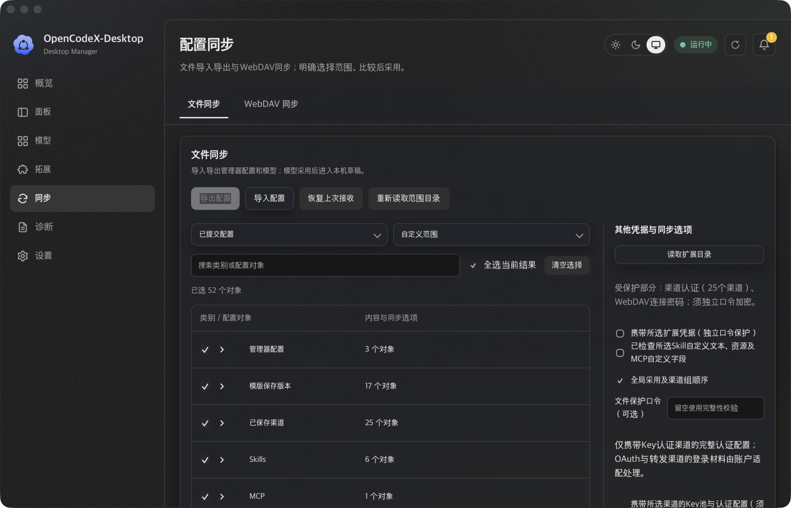
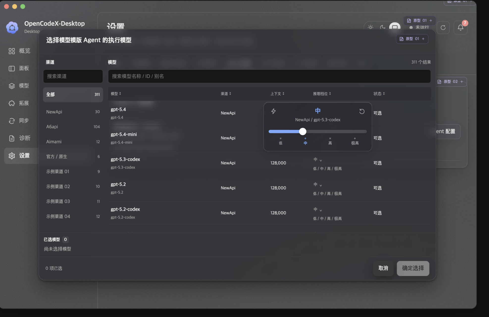
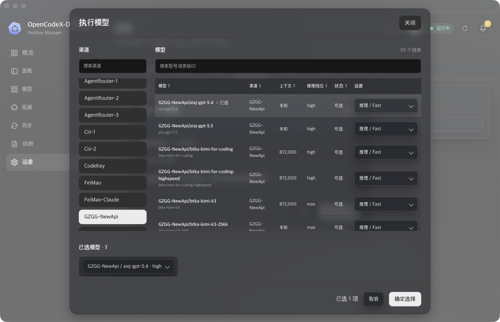
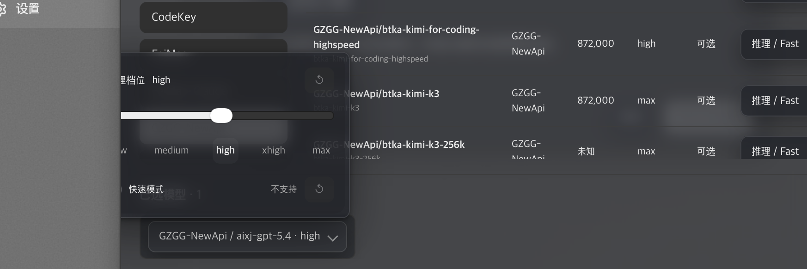
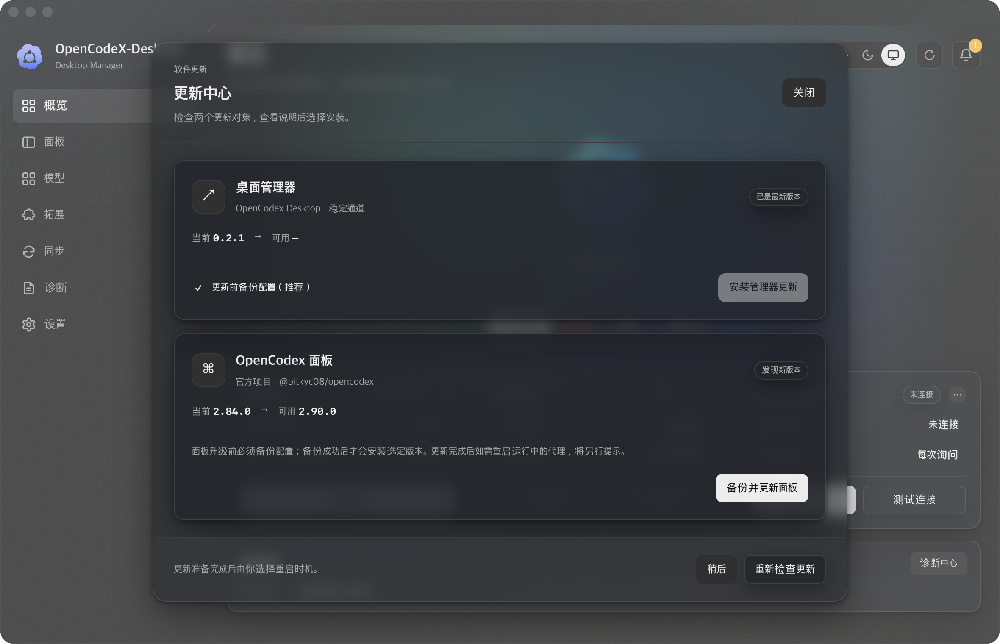
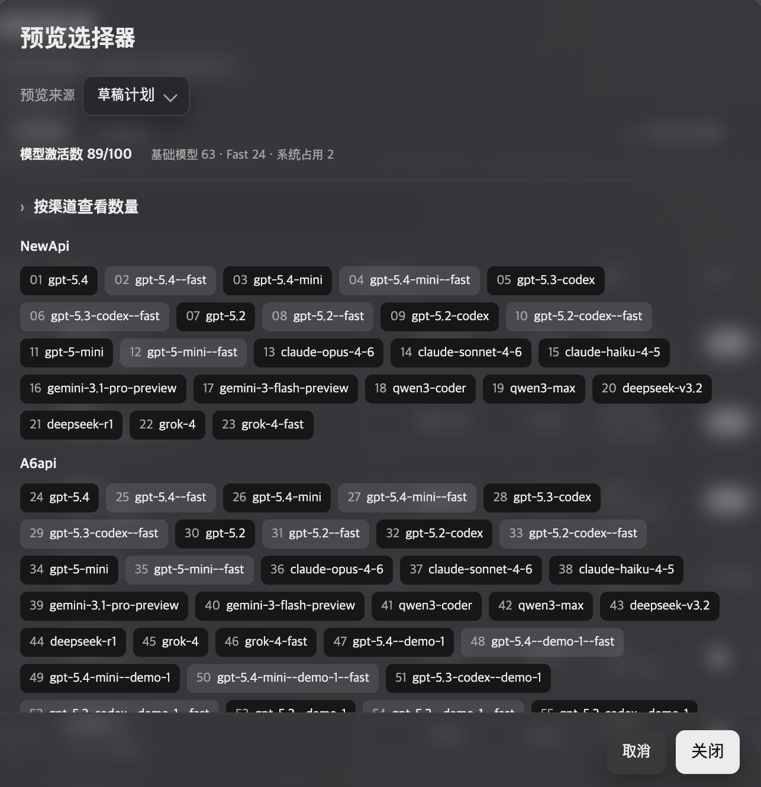
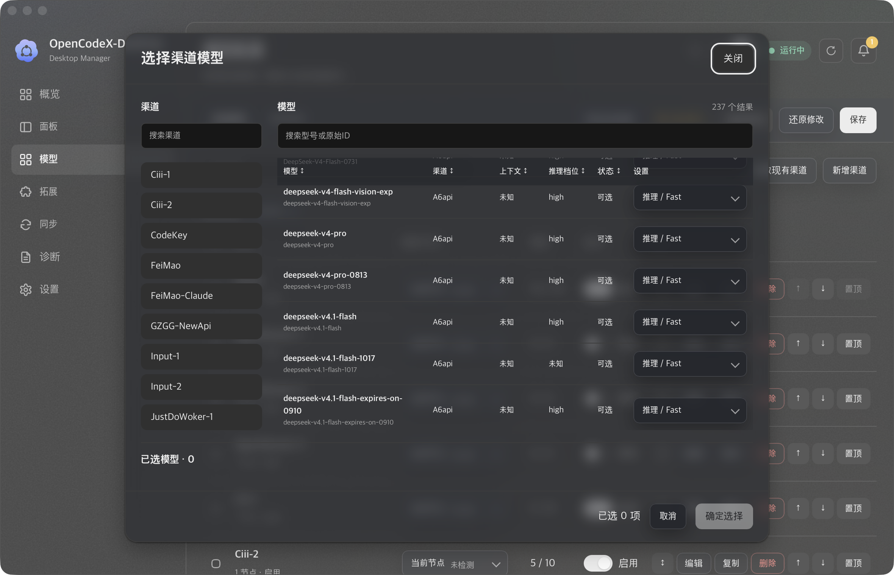

# 0.2.1 发布后 UI 问题清单（下一修复版本待定）

2026-10-21，Asia/Shanghai。0.2.1 stable 发布后发现的新一轮问题，按维护记录方式单独登记，不重开已完成的 [0.2.1 UI 问题清单](20261021-0.2.1-UI问题清单.md)、[IMP-22](../../../../../03-开发实施/IMP-OPENCODEX-DESKTOP-22.md) 或 [REL-12](../../../../../03-开发实施/REL-OPENCODEX-DESKTOP-12.md)。下一修复版本暂未确定；进入开发前仍须先确认范围、版本归属和验收入口。

基线：0.2.1 stable，main/tag `fbd6e1d17a9029c89807100dab6f3f7089559c44`。本清单只记录现象、根因边界和修复条件，不修改应用代码、不生成新版本、不替换日常安装或配置。

## 问题条目

| 编号 | 页面/控件与环境 | 现象及来源 | 期望效果 | 影响范围 | 状态 | 修复与验证 |
| --- | --- | --- | --- | --- | --- | --- |
| UI-016 | 同步 → 文件同步 → 其他凭据与同步选项；0.2.1 stable，暗色，用户 Appshot，窗口逻辑尺寸/缩放未读取 | “文件保护口令（可选）”与“受保护部分：渠道认证（25个渠道）、WebDAV连接密码；须独立口令加密”同时出现，但口令为空时“导出配置”不可用；用户原话：“你既然允许可选，但是又变成了必要条件。” | 含受保护内容时明确标为当前范围必填，或提供“不含凭据导出”和“含凭据导出”的清楚分支；不含受保护内容时才显示可选。不得静默取消加密要求。 | 文件同步范围状态、WebDAV连接密码、渠道Key、扩展凭据、导出准备与导入提示 | 待修复 | 未实施；根因和验收条件见下文。 |
| UI-017 | 同步 → 文件同步 → 其他凭据与同步选项；已选 Skills/MCP 时 | “已检查所选Skill自定义文本、资源及MCP自定义字段”呈现为普通可选复选框，但选中 Skill/MCP 后它实际是导出门；未勾选时导出被禁用。用户还指出可选外观与必要条件相矛盾。 | 将它呈现为有明确范围的检查步骤，显示待检查对象和检查结果；选择变化后重新要求检查；提供移除扩展内容的出口。不要把它伪装成无副作用的普通偏好。 | Skills/MCP 选择、扩展资源读取、导出前检查、后端 asset_review 门 | 待修复 | 未实施；前端确认状态绑定与后端强制条件均需统一。 |
| UI-018 | 同步 → 文件同步 → 导出配置按钮及右侧选项 | “导出配置”灰色时，按钮旁没有具体缺少哪一项的可读提示；受保护内容摘要、口令字段和扩展检查分散在右侧，用户需要自行猜测。截图同时显示口令为空、扩展检查未勾选。 | 在按钮附近显示“导出前待完成”清单，逐项说明缺少口令、缺少扩展检查、缺少范围、目录读取中等原因；修复后自动消失，键盘和读屏可发现。 | 导出按钮的禁用/可用状态、表单错误状态、无障碍提示、同步页窄窗与暗色 | 待修复 | 未实施；禁用状态和提示需统一由同一前置条件计算。 |
| UI-019 | 设置 → Agent 配置 → 执行模型选择器（也适用于模型页选择器）；0.2.1 stable，暗色，用户原图 | 正式选择器左侧每个渠道都显示为有独立背景的按钮，渠道列表看起来层层堆叠；原型的渠道列表使用透明行，只有当前渠道和悬停项显示背景。用户原话：“左边的渠道选择器变成丑陋的每一个渠道都有背景色。” | 左侧渠道列表恢复为低背景列表，仅当前项有选中高亮并在悬停/焦点时提供反馈；长名称、计数、滚动和“全部渠道”入口仍清楚。复用公共选择器配方，不用页面临时改色。 | 公共渠道模型选择器、Agent 执行模型弹窗、模型页预览选择器；亮暗、缩放和长渠道名 | 待修复 | 未实施；原型与正式 DOM/CSS 差异已核对，见下文。 |
| UI-020 | 设置 → Agent 配置 → 执行模型弹窗 → “推理 / Fast”浮层；0.2.1 stable，暗色，用户原图 | 推理档位浮层越过模型列表后，在弹窗边界被裁掉，底部内容无法读取和操作；原型浮层能完整覆盖在弹窗之上。用户原话：“推理小窗口超过弹窗就被隐藏了，这不对。说明弹窗超出元素都被隐藏有问题。” | 浮层必须可越过弹窗内容边界，并根据可用空间向上或向下定位、限制在窗口内；不得因父级滚动容器裁切。保留焦点、Escape、外部点击关闭和滚动重定位。 | 公共 UiSelectMenu/ModelChoiceOptions、模型选择器、执行模型弹窗；所有使用弹窗内浮层的消费者 | 待修复 | 未实施；当前浮层挂载与 `overflow` 裁切根因已核对。 |
| UI-021 | 概览/设置 → 更新中心 → 管理器与面板卡片按钮；0.2.1 stable，暗色，用户 Appshot | 点击“检查更新”后，底部“重新检查更新”变为“检查中”并显示旋转指示，管理器与面板两个更新按钮只变灰，没有动画也没有“检查中”文案；用户原话：“我建议检查更新的时候，管理器和面板的更新按钮页面成动画。跟底部一样。” | 检查进行中时，两个对象按钮用同一公共按钮加载态显示“检查中”和旋转指示，并与底部按钮同步；检查结束后恢复真实结果（可更新 / 已是最新 / 检查失败），不得让检查动画被误读为正在安装。 | 更新中心三个动作按钮、检查并发状态、低画质动画、无障碍状态播报 | 待修复 | 未实施；按钮绑定差异与低画质规则见下文。 |
| UI-022 | 模型 → 渠道模型 → 顶部“预览选择器”；0.2.1 stable，暗色，用户 Appshot | 点击“预览选择器”打开的是交互式“选择渠道模型”弹窗（渠道搜索、模型勾选、推理/Fast 设置、确定选择），可以改变选择；原型打开的是只读的目录预算预览（预览来源、模型激活数 89/100、按渠道查看数量、按渠道分组的完整编号顺序、关闭）。用户原话：“渠道模型的预览选择器弹出窗口错误，应该是图片这个才对。” | 恢复原型语义：只读预览当前草稿或已保存配置的完整发布顺序与激活预算，不提供勾选、不写入配置；交互式选择器保留给真正需要选择模型的消费者。 | 渠道模型页顶部入口、渠道详情侧栏入口、激活预算展示、与 Agent 执行模型选择器的区分 | 待修复 | 未实施；两个弹窗的功能边界与源码依据见下文。 |
| UI-023 | 模型 → 渠道模型 → “读取现有渠道”；0.2.1 stable，暗色，用户 Appshot | 只点击“读取现有渠道”，未改任何字段，顶部即出现“未保存修改”，“还原修改”“保存”同时可用；用户原话：“分析为什么我只是读取现有渠道然后就存在未保存修改？” | 读取本身不应产生待保存变更：若上游内容与当前草稿等价，读取后保持“未修改”；若确有上游变化，应明确列出变化项并要求确认纳入草稿，再决定是否标记未保存修改。 | 渠道草稿脏检查、上游合并、“查看草稿”差异展示、还原修改语义 | 待修复 | 未实施；两个根因、实测循环与查看草稿渲染证据见下文。 |

## UI-016 保护口令的可选语义与受保护内容

用户原话：“那么就矛盾了，你既然允许可选，但是又变成了必要条件。我觉得需要记录新一轮bug，像之前那样。”

原始用户 Appshot 已按原字节保存；SHA-256 为 `e6bf07ade74243e57eb7fc78ca6835eb11c2a38ec373ff8008bb8e344380404e`，尺寸 1984×1277。另存有局部审阅图：[导出按钮与右侧条件](附件/0.2.1发布后问题/UI-016-导出按钮与右侧条件-局部.png)。原图没有显示任何明文 Key；口令字段为空白。

### 实际行为与源码依据

当前 `0.2.1` 的 `apps/desktop/ui/src/features/sync/ModelTransfer.vue`：

- 第 60 行 `requiresPassword` 在导出 Key、扩展凭据或 WebDAV 密码参与时变为真。
- 第 230 行把 `requiresPassword && !exportPassword` 直接放入“导出配置”的禁用条件；该表达式没有在按钮旁生成可读的缺项说明。
- 第 250 行始终显示“文件保护口令（可选）”，占位文字是“留空使用完整性校验”。当第 60 行为真时，这句“可选”与实际必要条件冲突。
- 第 247 行只把受保护摘要放在右侧，文案为“须独立口令加密”；这与“可选”并列时没有解释“当前范围为什么已经不能留空”。

后端 `apps/desktop/tauri/src/modules/sync/portable_file.rs` 第 102～107 行在 `secret_objects > 0` 且没有口令时返回 `passphrase_required`。因此受保护内容必须有口令，不能为了消除灰色按钮而放宽为明文导出。这里需要修复的是**条件标签与解除路径**，不是安全约束。

### 修复建议

1. 把口令标题改成由当前范围决定的文案：没有受保护内容时为“文件保护口令（可选）”；有受保护内容时为“文件保护口令（当前范围必填）”或“含凭据时必填”，并加可见的必填标识、`required`/`aria-required` 和就近说明。
2. 在口令字段上方直接列出当前受保护对象及数量，例如“25 个渠道认证、1 个 WebDAV 连接密码”；说明“移除这些对象后可改用不含凭据的导出”。不要把正式密钥或用户输入的口令值写入提示、日志或截图。
3. 提供可执行的解除路径：切换到“分享配置 · 不含凭据”，或展开对象树把对应对象设为“仅配置”、取消渠道 Key/扩展凭据；切换后立即更新口令必填状态和按钮。
4. 也可以采用二分选择：“不含凭据导出（完整性校验）”和“含凭据导出（必须设置保护口令）”。若采用此方案，选择受保护对象时自动进入含凭据分支，并保留用户已作的选择。
5. 不得默认生成或静默复用口令；口令仍由用户明确设置，导入时需要再次输入。

### 验收条件

- 仅选择不含凭据的模版/普通配置时，口令显示可选，留空可以生成完整性校验包；导入端不要求口令。
- 选择渠道认证、WebDAV 密码或扩展凭据时，标题、必填标识、就近说明和按钮原因一致；留空不能导出，填写后才可用。
- 去掉全部受保护对象后，状态回到可选；不残留旧口令、不自动把旧口令带入新范围。
- 亮暗、窄窗、50%/150%/200% 缩放、键盘/读屏下标签和提示可读；任何截图和状态文本不出现秘密值。
- 预览与最终导出仍显示受保护对象数量；实际包在无口令时由后端拒绝，不能只靠前端灰按钮。

## UI-017 扩展内容检查不是普通可选复选框

当 Skills/MCP 被选中时，当前 `ModelTransfer.vue` 第 248 行显示“已检查所选Skill自定义文本、资源及MCP自定义字段”。它看起来是一个普通可选复选框，但第 230 行的 `hasAssets && !assetsReviewed` 使其成为导出门；用户原图里已选 6 个 Skills、1 个 MCP，复选框未勾选，导出按钮灰色。

后端 `apps/desktop/tauri/src/modules/sync/portable_assets.rs` 第 287～291 行对 Skill 快照强制要求 `reviewed`；第 433～437 行对含未知自定义字段的 MCP 同样返回 `asset_review`。因此这项确认本身是必要的，问题在于界面把它伪装成普通偏好，且没有让用户先看到要检查的内容。

此外，当前前端只要选择了任一 MCP 就要求确认，后端仅对含未知自定义字段的 MCP 强制确认；产品需要决定“所有 MCP 都要求确认”还是“只对实际需要检查的 MCP 要求确认”，并让前后端口径一致。另有一个状态绑定风险：`applyScopePreset` 会重置 `assetsReviewed`，但 `updateScopeKeys` 在用户新增或替换 Skill/MCP 时没有重置已勾选的确认；用户可以确认旧对象后再改选，确认可能错误地沿用。

### 修复建议

1. 将其改成“检查所选扩展内容”的明确步骤，显示对象数量与名称，例如“待检查：6 个 Skills、1 个 MCP”；不要把它放在普通选项区。
2. 检查步骤应能查看 Skill 文件/自定义文本、MCP 自定义字段和警告；确认后显示“已检查”状态，并绑定当前确切的 selection 快照。选择变化后必须重置并要求重新确认。
3. 提供“移除 Skills/MCP，仅导出其他配置”的出口；这可以和 UI-016 的不含凭据方案共用范围操作。
4. 统一前后端：如果选择任意 MCP 都需要人工检查，就在标签和文档明确；如果不需要，则前端不要提前禁用所有 MCP。Skill 仍按后端要求确认。
5. 不要默认自动勾选“已检查”；用户必须看到内容并明确确认。

### 验收条件

- 选中 6 个 Skills 和 1 个 MCP 时，页面显示待检查数量和明确入口，未确认时导出被阻止且原因可见。
- 检查完成后导出可用；改变选择的任一 Skill/MCP 后确认状态失效，必须重新检查。
- 取消全部 Skills/MCP 后检查步骤消失，其他配置仍可导出。
- 只有普通 MCP 时按产品确定的规则处理；前后端不会出现“前端要求但后端不需要”或“后端拒绝但前端不提示”的分歧。
- 检查视图不展示明文秘密；键盘、读屏、窄窗、亮暗和缩放均可用。

## UI-018 禁用按钮没有可执行的缺项说明

用户看到的是“导出配置始终灰色”，但页面没有把阻断项集中到按钮附近。当前右侧虽然显示受保护摘要和两个复选框，却没有说明“口令为空”“扩展检查未完成”分别是否阻断；禁用按钮本身通常也不能获得焦点，键盘和读屏用户更难发现原因。

### 修复建议

1. 在导出按钮附近增加“导出前待完成”区域，按顺序列出当前阻断项；例如“设置文件保护口令（当前范围含 25 个渠道认证和 WebDAV 密码）”和“确认所选 6 个 Skills、1 个 MCP 已检查”。
2. 使用同一份计算状态同时驱动按钮和待完成清单，避免按钮表达式与右侧提示各维护一套条件；提示区域使用可读的 `role="status"` 或 `aria-describedby`，不要只依赖浏览器原生 tooltip。
3. 可以保留禁用按钮，但必须让提示始终可见；也可以在范围非空时让按钮可点击，点击后打开“准备导出”并集中展示缺项。两种方案二选一，不能继续让用户猜。
4. 缺项修复后即时消失；目录读取中、范围为空、模板族不完整、导出草稿未选渠道等既有条件也纳入同一清单，不只修口令和扩展检查。
5. 提示只写对象类别、数量和原因，不写秘密值或用户输入的口令。

### 验收条件

- 默认/自定义范围包含受保护对象和扩展内容时，按钮旁同时显示两项具体缺项；修复任一项后对应条目消失，全部修复后按钮可用。
- 仅缺一项时只显示一项，不复制无关提示；范围为空、目录读取中、簇范围不完整也各有准确文案。
- 鼠标、键盘、读屏在 1180×760、窄窗、亮暗、50%/150%/200% 缩放下能读到提示；不依赖 hover 才能发现。
- 禁用状态不再只靠颜色和按钮属性；错误/忙碌/空状态不会错误显示为可导出。
- 最终导出仍经过现有预览、冻结、口令校验和后端安全检查，UI 提示不替代后端门。

## UI-019 渠道选择器的行背景与原型不一致

用户原话：“还有这里的样式有问题，对比原型，左边的渠道选择器变成丑陋的每一个渠道都有背景色。”

两张用户原图已保存，原字节 SHA-256 分别为 `3fb192d3f003c5e9f5487a3b96e0c974412a7412556bc3ced2afa9b3c82d8fcd`（正式，1975×1280）和 `e5af3e3272aed21a98c30bd2dc65bcf2e8f9119462e4696f3f39de22cd9900b6`（原型，1984×1277）。正式截图为“执行模型”弹窗，左侧渠道呈逐个卡片背景；原型截图为同一选择器的完整布局，渠道列表为透明行并通过当前项高亮。

### 实际行为与源码依据

当前 `apps/desktop/ui/src/features/models/ModelPicker.vue` 第 85 行把每个渠道渲染成 `UiButton`，并在选中时切到 `primary`；第 100～101 行的局部样式只调整换行和对齐，没有为左侧列表定义透明行、当前项和悬停背景层。正式按钮自身的表面配方因此把每个渠道都画成独立控件。

原型的 `model-picker.css` 第 26～30 行使用无边框、透明背景的 `.mpk-channel` 行，只有 `[aria-current=true]` 和 `:hover` 才显示背景；同一行为还显示渠道计数。原型的选中状态是列表行，不是主按钮。

### 修复建议

1. 为公共选择器增加渠道行的 view/recipe：透明底、整行可点击、当前项使用轻量选中背景和文字强调；不要再复用 `UiButton variant=primary` 作为唯一渠道项。
2. 保留“全部渠道”作为独立的列表首项，渠道搜索结果、长名称换行、计数和滚动位置均不改变；键盘上下移动与当前项同步。
3. 将当前项和悬停态定义为可读的 `aria-current`/焦点状态，不靠背景色单独表达；亮暗主题使用共同语义材质，低档材质也不能退回“每项一块背景”的旧形态。
4. 若业务需要分隔线或选中指示条，先补公共 recipe 和 Gallery 样例，再由 Agent 执行模型与模型页消费者使用同一实现。

### 验收条件

- 未选中项无独立按钮底色；当前项有单一、清晰的高亮，悬停和键盘焦点有反馈，不出现逐个卡片堆叠的观感。
- “全部渠道”、搜索结果和当前筛选保持可达；长渠道名、计数和窄窗滚动不被裁切。
- 选择渠道后模型表格筛选、当前项高亮和键盘焦点一致；不改变模型排序、选择或执行配置保存语义。
- 亮暗主题、高中低材质、50%/150%/200% 缩放和弹窗内实际消费者均可读；不只在 Gallery 里通过。
- 静态消费者守卫不能只查按钮字号，还要确认没有页面用按钮背景配方覆盖渠道列表行。

## UI-020 推理浮层被弹窗内容边界裁切

用户原话：“推理小窗口超过弹窗就被隐藏了，这不对。说明弹窗超出元素都被隐藏有问题。”

用户原图 SHA-256 为 `9b2360903bd6a712f7cd7037928b8d58176fa2a03669b96c2375db190aa02cfe`，尺寸 1746×582。截图中推理档位面板的左下部分越过模型列表底部后被弹窗裁剪，不能完整操作。

### 实际行为与源码依据

`ModelChoiceOptions.vue` 通过 `UiSelectMenu` 打开推理面板；`UiSelectMenu.vue` 第 125～130 行用 Teleport，但目标取 `anchor.value?.closest('dialog, .app-window, [data-ui-overlay-root]')`，在弹窗内会挂到 `dialog` 本身。`UiDialog.vue` 第 43 行的 `.ui-dialog-content` 设置 `overflow: auto`，因此浮层即使绝对定位也会被 dialog 内容滚动容器裁切；第 22～39 行的定位又按宿主弹窗的边界换算坐标，未把浮层脱离内容滚动区。

原型的 `model-picker.js` 第 32 行把推理浮层直接挂到 `document.body`，`model-picker.css` 第 126 行使用 `position: fixed` 并计算窗口边界；这与正式把浮层挂在 dialog 内是根本差异。弹窗的 `overflow` 只应裁切正文内容，不能裁切需要越界的浮层。

### 修复建议

1. 让公共浮层默认使用顶层 portal（body 或专用 overlay root），不要默认挂到带 `overflow` 的 dialog 内容容器；在缩放、主题和原生壳内使用统一的固定/绝对定位换算。
2. 根据触发元素与窗口可用空间向上或向下定位，浮层整体限制在可视窗口内；空间不足时缩短可滚动内容，不能裁切关键按钮和值。
3. 保留当前 `UiSelectMenu` 的键盘、焦点恢复、外部点击、滚动和 resize 重定位；浮层仍在弹窗打开期间可交互，不改变弹窗的关闭/焦点语义。
4. 对所有弹窗内消费者统一修复，不只给 ModelPicker 加一层 `overflow: visible`；局部 CSS 不得绕过公共浮层规则。

### 验收条件

- 在 1180×760 和适用窄窗中打开推理 / Fast 浮层，面板完整可见、可滚动、可点击，不越过窗口或被 dialog 裁切。
- 浮层在列表底部、弹窗滚动到顶/底、150%/200% 缩放下自动向上/向下定位；修改档位后浮层不跳动、不丢焦点。
- Escape、外部点击、滚动和关闭模型选择器均正确收起浮层并恢复触发点焦点；不留下悬挂 portal。
- 同一公共浮层用于其他弹窗消费者时行为一致；亮暗与高中低材质没有裁切、遮挡或层级错误。
- 实际 DOM 检查父级 `overflow` 和 portal 目标；仅源码包含 `position: fixed` 不算通过。

## UI-021 检查中新旧按钮的加载态不一致

用户原话：“我建议检查更新的时候，管理器和面板的更新按钮页面成动画。跟底部一样。”

用户 Appshot 已按原字节保存；SHA-256 为 `d3e139d32b0d06bba1b7149db1ed2fbc0c885ce53e8ea72a95829de361da62ba`，尺寸 2360×1520。截图同时显示管理器“已是最新版本”、面板“发现新版本”，两处按钮都呈灰色静止态。

### 实际行为与源码依据

当前 `apps/desktop/ui/src/features/updates/UpdateCenter.vue` 的三个动作用了不同绑定：

- 第 241 行底部按钮：`:loading="session.checking"`，文案在 `session.checking ? '检查中' : '重新检查更新'` 之间切换，因此检查时有公共旋转指示。
- 第 216 行管理器按钮：`:loading="managerBusy"`，只反映安装/更新忙碌；`session.checking` 只经第 46 行 `busy` 进入 `:disabled`，所以检查中它只是被禁用，没有加载态。
- 第 238 行面板按钮：`:loading="officialBusy"`，同样不反映 `session.checking`，也不反映面板自身的 `app.officialProjectLoading` / `app.officialRemoteLoading`。

第 84～92 行 `check()` 用 `Promise.allSettled` 并发管理器检查与面板两项查询，只维护一个全局 `session.checking`；面板另有独立加载标志。结果就是“同一轮检查”在三个按钮上呈现三种状态：底部有动画，两个对象没有；对象按钮也无法区分“检查中”和“正在安装”。

公共侧已具备能力：`UiButton.vue` 的 `loading` 同时设置 `aria-busy`、禁用和 `.btn-spinner`（`base.css` 第 262～273 行），且加载时隐藏文字、保持按钮宽度不跳动。这里缺的是对象级状态绑定和“检查中”文案，不是新的动效配方。

原型 `maintenance-ui.js` 第 9 行把 `checking` 作为对象自身阶段，标签为“检查中…”；第 138～143 行按对象阶段渲染按钮，检查中禁用该对象的操作。原型没有给按钮加旋转，但语义是对象级“检查中”，而不是全局忙碌。

### 修复建议

1. 为更新对象动作登记“检查中”状态：复用 `UiButton` 的 `loading`，文案用“检查中”，不要新增页面临时 spinner 或只改透明度。
2. 按对象而不是全局绑定：管理器用管理器检查在途状态；面板用 `app.officialProjectLoading || app.officialRemoteLoading`（必要时再加 `session.checking` 兜底），让两个对象各自准确表达。
3. 区分“检查中”和“更新中/安装中”：加载态文案与 `aria-busy` 必须随阶段变化；安装进度仍以现有 `update-progress` 区域为准，不能用检查动画代替。
4. 检查结束后回到真实结果：已是最新时按钮不应继续像“可安装”的主按钮，应显示“已是最新版本”或等价禁用原因；检查失败时给“重试检查”。禁用原因与 UI-018 的缺项提示共用同一套可见状态。
5. 低画质与减少动态：原型 `prototype-ui.css` 第 25 行在 mid/low 画质下关闭 spinner 动画；正式实现应遵循同一规则，并在 `prefers-reduced-motion` 下改为静态指示，不留无限旋转。当前 `base.css` 尚无 `prefers-reduced-motion` 规则，需随本项补齐。
6. 读屏与键盘：检查中给出可读的 `aria-busy` + 状态文本，结束后用 `role="status"` 播报“已是最新版本 / 发现新版本 / 检查失败”，不依赖动画本身传达结果。

### 验收条件

- 点击“检查更新”后，管理器、面板和底部三个按钮在同一轮检查内都进入加载态；两个对象按钮显示“检查中”与旋转指示，不再只变灰。
- 管理器与面板分别检查时各自状态准确：一个先返回时不提前结束另一个的加载态，也不把未返回的对象显示为“已是最新”。
- 检查结束后按钮文案与结果标签一致（可更新 / 已是最新 / 检查失败）；检查动画不会与安装进度混淆，安装仍显示“更新中”和独立进度。
- 加载时按钮宽度不跳动，键盘焦点不丢失；`aria-busy` 与结果播报可被读屏读取。
- 高画质显示旋转；mid/low 画质与 `prefers-reduced-motion` 下不出现无限旋转，仍能看出“检查中”。
- 亮暗、1180×760、窄窗与 150%/200% 缩放下三个按钮状态一致；静态守卫覆盖对象级绑定，避免以后又只给底部按钮加加载态。

## UI-022 “预览选择器”误用了交互式模型选择弹窗

用户原话：“渠道模型的预览选择器弹出窗口错误，应该是图片这个才对。”

两张用户原图已按原字节保存。正确形态图 SHA-256 `760b9c37e4d860330dc0de63e16d92c8796e8ea99c44995524fc14f22ceddc73`，1286×1330；正式 0.2.1 图 SHA-256 `01a24fc21b749b484a5e1fb135227e6cfa5ef4b4edf1cbdae4842ca2677dad4e`，2360×1520。正确形态图包含示例渠道名与型号（NewApi / A6api 等），属于原型演示数据；正式图是用户本机渠道与型号清单，只保留在维护附件，不作为公开示例。

### 实际行为与源码依据

- `apps/desktop/ui/src/features/models/ChannelsView.vue` 第 166～171 行 `showPreview()` 只做两件事：调用 `modelApi.project(channelDraft)` 得到投影，然后 `pickerOpen.value = true`。
- 同文件第 198 行把该状态直接交给 `ModelPicker`：`<ModelPicker :open="pickerOpen" ... reasoning @close="pickerOpen = false" @confirm="pickerOpen = false" />`。`reasoning` 打开的是交互式档位设置，`confirm` 只是关闭弹窗，没有保存语义。
- `apps/desktop/ui/src/features/models/ModelPicker.vue` 第 82 行标题默认“选择渠道模型”，正文是渠道搜索 + 模型表格 + 勾选 + “推理 / Fast”设置 + “已选模型” + “取消 / 确定选择”。这是选择控件，不是预览。
- 投影里其实已经具备预览所需数据：`DraftProjection` 提供 `rows`（含 `channelId`、`enabled`、`selected`、`discovered`、`rules.fast`）、`knownActiveModels`、`exactCatalogCount`，`compiler.rs` 第 332～341 行按 `selected && enabled && discovered` 计算激活数。也就是说，缺的是预览视图，不是数据。

原型侧 `model-config.js` 第 493～504 行是独立实现：`preview()` 按 `policy.providers` 顺序生成分组，逐项编号（`01`、`02`…），Fast 项紧跟父项并使用强调色，隐藏目录项单独样式；顶部是“预览来源（草稿计划 / 已保存配置）”“模型激活数 xx/100”“基础模型 · Fast · 系统占用”，下面是“按渠道查看数量”折叠区和完整顺序；“关闭”即可，没有确定选择。`model-selector-preview.test.cjs` 还断言了切换来源后草稿不变。

需求侧也早有结论：[选择器预览与模型预算合并](../../01-需求分析/06-版本记录/20261014-选择器预览与模型预算合并.md) 明确“弹窗标题为预览选择器，包含 mpPreviewSource 来源选择、mpPreviewBudget 数量 / 基础模型 / Fast / 系统占用、按渠道数量折叠区与完整编号顺序”，且“预览不改变配置或实际选择”。当前实现只借用了入口名称，功能没有落地。

### 修复建议

1. 新增只读预览视图（例如 `SelectorPreviewDialog`），与 `ModelPicker` 彻底分开；不要把 `ModelPicker` 加个 `readonly` 参数硬改，两者交互、按钮和语义都不同。
2. 预览内容按原型：预览来源（草稿计划 / 已保存配置）、激活数与 基础 / Fast / 系统占用 拆分、按渠道数量折叠区、按渠道分组的完整编号顺序、Fast 标记与隐藏项样式。
3. 只读：没有勾选、没有“确定选择”；底部只保留“关闭”。切换来源不写入配置、不改变草稿、不触发保存或重启状态。
4. 两个来源共用同一投影口径，并区分“已保存”与“客户端已加载”：已保存配置待重启时按原型显示提示，不能用预览冒充运行态证据。
5. 预算口径保持后端为唯一来源：`knownActiveModels` 只统计 `selected && enabled && discovered`；`exactCatalogCount` 目前为 `null`，预览需明确标注“完整目录待保存前核对”，不得把估算数当真实上限结论。原型 100 是兼容演示阈值，不要写成永久容量。
6. 入口保持一致：列表顶部与渠道详情侧栏都指向同一预览；交互式 `ModelPicker` 继续服务 Agent 执行模型等真正需要选择的场景，避免用户在两处看到同名但行为不同的弹窗。

### 验收条件

- 点击渠道列表或渠道详情的“预览选择器”，打开的是只读预览：可切换草稿 / 已保存来源，能看到激活数、基础 / Fast / 系统占用和按渠道分组的编号顺序，底部只有“关闭”。
- 预览里没有任何勾选、档位设置或“确定选择”；全程不写入配置，关闭后草稿、保存状态和待重启状态与打开前一致。
- 顺序与渠道顺序、内部模型顺序一致；Fast 紧跟父项并有可辨认标记；停用渠道与隐藏项按原型区分展示，且不误计入激活数。
- 草稿与已保存两种来源的数字和分组各自正确；已保存待重启有明确提示，不宣称客户端已加载。
- Agent 执行模型弹窗仍是交互式选择器，标题与按钮保持“选择 / 确定选择”，两个弹窗不会再被混淆。
- 亮暗、1180×760、窄窗、150%/200% 缩放和键盘/读屏可用；长渠道名与超过 100 项的目录不被截断或静默省略。

## UI-023 “读取现有渠道”后立即出现未保存修改

用户原话：“分析为什么我只是读取现有渠道然后就存在未保存修改？”

截图显示：只点击了“读取现有渠道”，未编辑任何字段，顶部状态已经是“● 未保存修改”，“还原修改”“保存”均为可用态，来源提示为“opencodex 2.84.0 · 已读取到草稿”。

### 根因一：脏检查用“归一化前的原始 JSON”比对

<code>apps/desktop/ui/src/features/models/store.ts</code> 第 67 行：

    const channelDirty = computed(() => channelDraft.value !== null && JSON.stringify(channelDraft.value) !== channelClean.value)

<code>channelClean</code> 只在三处写入，全部直接 <code>JSON.stringify</code>：

- 第 76 行 <code>load()</code>：<code>channelClean.value = JSON.stringify(snapshot.value.policy)</code>
- 第 130 行 <code>restoreChannels()</code>：对当前草稿取快照
- 第 137 行 <code>acceptTransfer()</code>：<code>JSON.stringify(saved.policy)</code>

而读取写入草稿的是 <code>ChannelsView.vue</code> 第 108～121 行 <code>readUpstream()</code> → <code>upstream.ts</code> <code>mergeUpstream()</code> 产生的对象。两边序列化形状不同，<code>JSON.stringify</code> 就把“等值但不同形”判成修改。本机实测正是这一类：

- 磁盘草稿 <code>manager-state/model-config-draft.json</code> 中 25 个渠道、235 个已发现模型，<code>rules</code> 只有 6 个键（protocol、contextWindow、inputModalities、reasoningEfforts、defaultEffort、fast）。
- 前端 <code>emptyRules()</code> 产生 11 个键，另外 5 个（pinnedEffort、effortMap、noReasoning、reasoningAuthoritative、fastWire）保持 inherit 时被后端 <code>skip_serializing_if = "is_inherit"</code> 省略。
- 后端 <code>schema.rs</code> 第 71～80 行确认这 5 个字段在 inherit 时不落盘。

用本次读取基准（<code>model-source-reads/9c165cf1-….json</code>）重算合并结果并与草稿逐模型对比：**新增 0、删除 0、显示名变化 0、真实取值差异 0**；235 个模型的差异全部只是“多出 5 个 inherit 键”。用户看到的“未保存修改”来自序列化形状差，不是内容变化。

### 根因二：sourceReadId 每次读取都换新，而它被算进草稿

<code>upstream.ts</code> 第 29、33 行在合并时把 <code>sourceReadId</code> 覆盖为本次读取的 <code>snapshot.readId</code>。后端 <code>channel_actions.rs</code> 第 33～56 行 <code>remember()</code> 每次读取都用 <code>uuid::Uuid::new_v4()</code> 生成新 id，因此同一份内容再读一次也会得到不同 <code>sourceReadId</code>。

它确实属于要保存的字段：<code>policyChanges.ts</code> 第 18 行会把它作为“本机读取基准”变更展示，保存计划也据此做删除边界。因此不能简单从比较中剔除，否则会掩盖真实基准变化。

本机证据：<code>manager-state/model-source-reads/</code> 下有 3 份读取回执（12:33、22:48、23:51），每份 25 个渠道；但当前草稿 25 个渠道的 <code>sourceReadId</code> 全部是最近一次的 <code>9c165cf1-…</code>。每次读取都会整体改写这 25 个字段。

### 为什么“还原修改”也不能回到干净态

<code>restoreChannels()</code> 会把当前 <code>snapshot.policy</code> 复制回草稿，但 <code>channelClean</code> 同时被设为这份草稿序列化结果。若 <code>snapshot.policy</code> 来自落盘（6 键形状），而页面渲染与投影使用 11 键形状，恢复后仍会立刻再次变脏。更关键的是：**没有“以本次读取结果作为新基线”的路径**，用户只能保存一次来消除提示，这等于把一次纯读取变成了一次写入。

### 实测：保存一次修不好，每读一次脏一次

用真实的 <code>useModelsStore</code>、<code>mergeUpstream</code> 与后端落盘形状（inherit 字段被省略）跑“读取 → 保存 → 再读取”：

| 步骤 | <code>channelDirty</code> |
| --- | --- |
| 打开模型页 | false |
| 点“读取现有渠道” | **true** |
| 保存并重新载入 | false |
| 再点“读取现有渠道” | **true** |
| 第二次保存后再读取 | **true** |

结论：保存只能临时清掉提示，下一次读取立刻复现。原因是保存只把当时的 <code>sourceReadId</code> 写进 policy，而下次读取又生成一个新 id。这不是一次性误判，是稳定复现的循环。

归一化（剔除 inherit、统一键序）后逐叶子比对，草稿与基线只剩一处差异：<code>sourceReadId</code> 从 <code>read-1</code> 变为 <code>read-2</code>。两个原因必须同时修：只统一形状，读取仍因新 id 变脏；只忽略 id，235 个模型的形状差仍会报脏。

### “查看草稿”里用户实际看到的内容

<code>PolicyDraftDialog.vue</code> 第 8 行用 <code>policyChanges(props.saved, props.draft)</code> 生成差异，第 16 行把每个字段的 before/after 以 <code>JSON.stringify(value, null, 2)</code> 整段渲染。实测渲染结果：

- 变更分组显示为“A6api · 修改”，下面两项：“发现清单”与“本机读取基准”。
- “本机读取基准”的 before 是字面量 <code>"原读取基准"</code>，after 是 <code>"拟使用另一读取基准（不展示本机引用）"</code>。用户看不到任何有用信息，只知道基准换了。
- “发现清单”直接把整个 <code>discovered</code> 数组美化打印。单个模型时 before 26 行、after 51 行，差异全是多出的 5 个 <code>inherit</code> 字段。规模放大到 14 个渠道 × 17 个模型时，差异 JSON 约 173 KB、涉及 14 个渠道，全部是噪音。

也就是说，用户为了确认“我到底改了什么”打开查看草稿，得到的是大段 JSON 和一句“拟使用另一读取基准”。这与原型“查看草稿只展示真实修改、按字段归纳”的意图不符。

### 保存确认里的“本机读取基准”

保存确认（<code>ChannelsView.vue</code> 第 196 行 <code>saveOpen</code> 弹窗）不走 <code>policyChanges</code>，它只显示后端 <code>SavePlanView</code> 的 <code>changedChannels</code>、<code>catalogCount</code>、<code>routeChanges</code> 等。因此“本机读取基准”这一行只出现在“查看草稿”，不会出现在保存确认；但保存确认会把 25 个渠道整体列为变更范围。

### 保存不是空操作

<code>runtime.rs</code> 的 <code>apply</code>（第 2622 行起）会执行 <code>WriteOperation::Providers</code>、<code>Order</code>、<code>Sync</code> 等真实写入运行配置，完成后仍需重启 Codex 生效。为消除一个假的“未保存修改”而保存，等于触发一次真实写入与重启。

### 修复建议

1. 脏检查改为语义比较，不要直接比 <code>JSON.stringify</code>：比较前统一归一化，剔除 <code>mode: 'inherit'</code> 的字段并统一键顺序；或为草稿定义 <code>digest()</code>，前后端共用同一套 canonical 规则。
2. <code>sourceReadId</code> 不参与“内容是否修改”的比较，但必须参与“读取基准是否变化”的显式提示：读取后若基准变化，单独显示“已读取新的运行基准”，不要混进“未保存修改”。
3. 读取后建立新的干净基线：读取成功且用户确认内容后，将归一化后的草稿与基线对齐；若存在真实上游变化，列出新增、删除、字段变更让用户确认，再决定是否进入草稿。
4. 读取回执按“内容摘要 + 运行绑定”去重，内容未变时复用原 id；若保留新 id，则必须按第 2 条与脏状态解耦。
5. 补齐测试：读取同一份上游两次、读取后不做任何编辑，断言 <code>channelDirty === false</code>；上游真实新增或删除模型时，断言脏状态与变化清单同时出现。
6. “查看草稿”与脏检查共用同一套归一化比较，不能一边判脏、一边把 inherit 字段差异当修改展示；“发现清单”这类大字段应按“新增 N 个、删除 M 个、字段变化 K 项”归纳，而不是整段 JSON。
7. “本机读取基准”在查看草稿中改为可读说明（例如“已切换到本次读取的运行基准”），不要展示占位文案；只有用户主动切换来源或恢复历史时才作为变更列出。

### 验收条件

- 未编辑任何字段时点击“读取现有渠道”，若上游与草稿内容等价，顶部保持“未修改”，“还原修改”“保存”为禁用态。
- 连续读取两次，状态不发生翻转；<code>sourceReadId</code> 变化本身不把页面变成“未保存修改”。
- 上游确有新增、删除或规则变化时，明确列出变化项；用户确认纳入草稿后才出现待保存修改，可取消。
- 读取后草稿内容与落盘 policy 语义一致时，保存计划不出现“本机读取基准”之类的伪变更。
- 归一化比较对 5 个 inherit 字段、键顺序、空数组与 null 一致；亮暗与缩放不影响状态判定。
- “查看草稿”在仅形状差时不列任何字段；真实变化时按“新增 / 删除 / 字段变化”归纳，不再整段打印发现清单。
- “本机读取基准”不在每次读取后作为用户可见变更出现；确有来源切换时给出可读说明。

### 修复设计（按代码触点）

本节承接上面的根因与修复建议，给出可直接实施的技术路径。原则有三条：内容比较与“读取基准引用”分开；归一化只在数据边界做一次，脏检查与“查看草稿”共用同一个函数；不因为对齐形状而改落盘 schema 或做配置迁移。

#### 一、边界处做一次归一化（替代逐处补字段）

前端在 <code>store.ts</code> 的 <code>load()</code>、<code>restoreChannels()</code>、<code>acceptTransfer()</code> 三处入口对后端返回的 policy 统一执行 <code>normalizePolicy()</code>：按 <code>emptyRules()</code> 的 11 个键补齐缺失的 rules 字段，缺省即 <code>{mode:'inherit'}</code>。后端 <code>schema.rs</code> 第 71～80 行的 <code>skip_serializing_if = "is_inherit"</code> 保持不变。

这样处理的理由是：落盘形状是既成契约，已有 0.2.0/0.2.1 的配置文件、便携包、同步产物都按 6 键写入；改序列化会波及导出、同步、跨机恢复与旧客户端，成本远高于在读取边界补齐。补齐后前端内存中的 policy 始终是单一形状，脏检查、“查看草稿”、模型表格投影都拿到同构数据。

#### 二、用 canonical digest 取代 <code>JSON.stringify</code>

新增 <code>apps/desktop/ui/src/features/models/policyDigest.ts</code>，导出两个函数：

- <code>canonicalize(value)</code>：递归排序对象键；对 <code>{mode:'inherit'}</code> 的字段直接剔除（inherit 就是缺省态，与“键不存在”等价）；数组保持原顺序。
- <code>contentDigest(policy)</code>：在 <code>canonicalize</code> 结果上剔除 <code>connection.sourceReadId</code>，再取字符串摘要。

<code>store.ts</code> 改为：

- <code>channelDirty = contentDigest(channelDraft) !== channelCleanDigest</code>；
- <code>channelClean</code> 从“序列化字符串”改为“归一化后的摘要”，三处写入点同步调整。

<code>policyChanges.ts</code> 的 <code>changed()</code>（当前用 <code>JSON.stringify</code> 判等）改为调用同一 <code>canonicalize</code> 比较，保证“判脏”和“展示差异”不会再分叉。

保留 <code>JSON.stringify</code> 的地方是真正要把草稿发给后端的路径（<code>stageDraftLoop</code>、<code>save</code> 的请求体），那里需要完整字段，不做剔除。

比较范围必须保持严格：<code>credentialRef</code>、节点 URL、<code>enabled</code>、<code>selection</code>、<code>modelOrder</code>、<code>discovered</code>、overrides 等一律参与；只剔除 inherit 占位与 <code>sourceReadId</code>。剔除 inherit 不会掩盖真实修改——已存为 custom 的字段会以键形式留在摘要里，用户把它改回 inherit 时摘要仍然变化。

#### 三、<code>sourceReadId</code> 与内容脏状态解耦

<code>upstream.ts</code> 第 29、33 行继续更新 <code>sourceReadId</code>（保存计划与删除边界依赖它，见 <code>channel_actions.rs</code> 第 98～110 行的漂移校验），但它不再影响 <code>channelDirty</code>。新增一个独立派生状态 <code>baselineRefreshed</code>：草稿中各渠道的 <code>sourceReadId</code> 与 <code>snapshot.policy</code> 中的不一致时置为 true，界面用轻提示“已读取新的运行基准”表达，不显示“未保存修改”，也不启用“保存”按钮。

这让“保存”这个词重新只对应“我要写入运行配置”。纯读取既然不需要写入，就不该出现保存入口。

#### 四、读取后建立新基线，但只对等价内容自动生效

<code>ChannelsView.vue</code> 第 108～121 行 <code>readUpstream()</code> 在合并完成后按结果分流：

- 归一化摘要与当前基线一致：直接把 <code>channelCleanDigest</code> 更新为读取后的摘要，页面保持“未修改”，同时把新 <code>sourceReadId</code> 记为当前基准。这是纯读取路径，不触发写入。
- 摘要不一致：保持 dirty，并把差异按“新增 / 删除 / 字段变化”列在读取结果里，等用户确认后再进入草稿。

这条路径上还有一个隐藏写入要一起处理。<code>readUpstream()</code> 在 <code>channelDraft</code> 为空时会调用 <code>models.restoreChannels()</code>，而 <code>restoreChannels()</code> 末尾是 <code>queueDraft(true)</code>，force 参数跳过 dirty 判断，直接进入 <code>stageDraftLoop</code> 写 <code>model-config-draft.json</code>。也就是说，刷新页面后的首次读取会无条件落一份草稿。首读应该改为在内存里用归一化结果建立草稿与基线，不调用 <code>restoreChannels()</code>；只有确认存在真实差异时才 stage。

非首读路径因为 <code>queueDraft()</code> 在未 dirty 时直接 return，本来就不会触发 <code>stageDraftLoop</code>。验证时要实测草稿文件的 mtime 与内容在纯读取后不变，把“读取不写盘”作为硬约束，同时覆盖“刷新后首次读取”这个容易漏的分支。

#### 五、读取回执按内容去重

<code>channel_actions.rs</code> 第 33 行 <code>uuid::Uuid::new_v4()</code> 改为基于内容与运行绑定生成确定性 UUID（UUIDv5，命名空间取本模块常量，名字取 <code>binding + 快照的 canonical JSON</code> 摘要）。

这样同一份上游内容再次读取会得到同一个 id 和同一个文件路径，内容未变时写入等价字节，<code>sourceReadId</code> 自然稳定；内容变化时 id 变化，删除边界的漂移校验（第 101～110 行）依旧成立。若启用 <code>uuid</code> crate 的 <code>v5</code> feature 有顾虑，退路是先算摘要再查 <code>manager-state/model-source-reads/</code> 是否已有同摘要回执并复用其 id，语义一致但多一次目录扫描。

回执去重是根因二的正解；仅靠前端忽略 id 会让“基准切换”失去可审计记录。

#### 六、“查看草稿”按变化归纳展示

<code>PolicyDraftDialog.vue</code> 第 16 行当前把每个字段的 before/after 整体 <code>JSON.stringify(value, null, 2)</code>。改为：

- 小字段（名称、启用、范围、顺序、采用项、覆盖项、别名）保留前后对照，但值与判断都走 <code>canonicalize</code>，形状差不再出现在列表里。
- <code>发现清单</code> 换成摘要行：“新增 N 个型号 / 删除 M 个 / 字段变化 K 个”，展开才看明细；明细只列真正变化的型号与字段。
- <code>本机读取基准</code>（<code>policyChanges.ts</code> 第 18、20 行）把占位文案换成可读说明，例如“已切换到本次读取的运行基准（opencodex 2.84.0，25 渠道 / 235 型号）”；仅在基准确实切换时出现，且不作为“修改”计入变更数。

#### 七、实施顺序与不变量

顺序按依赖而非按文件：先 <code>policyDigest.ts</code> 与 <code>store.ts</code> 的脏检查（最小闭环，单独可验），再 <code>upstream.ts</code> 的读取分流与 <code>baselineRefreshed</code>，然后后端回执去重，最后 <code>policyChanges.ts</code> 与 <code>PolicyDraftDialog.vue</code> 的展示改造。前两步合起来就能消除用户看到的现象；后两步解决“查看草稿仍然荒谬”和“每读一次换一个 id”的深层问题。

必须守住的不变量：落盘 schema 与既有配置文件格式不变；纯读取不写 <code>model-config-draft.json</code>；<code>sourceReadId</code> 仍参与保存与删除校验；真实内容变化一定会让页面变脏并给出可读差异；<code>credentialRef</code> 与受保护内容继续不出现在任何差异展示中。

#### 八、测试清单

| 用例 | 期望 |
| --- | --- |
| 连续两次读取同一上游，期间不编辑 | 两次 <code>channelDirty</code> 均为 false；<code>sourceReadId</code> 两次相同 |
| 读取后不做编辑直接保存 | 保存入口为禁用态，不可能触发写入 |
| 上游新增或删除型号后读取 | dirty 为 true，差异摘要给出新增/删除数量，可取消 |
| 6 键落盘 policy 载入后立即判脏 | false（归一化补齐生效） |
| 同一 policy 不同键序 | 摘要相同 |
| <code>{mode:'inherit'}</code> 与键缺失 | 摘要相同 |
| 字段由 custom 改回 inherit | 摘要变化，判脏为 true |
| 仅 <code>sourceReadId</code> 变化 | 判脏 false，<code>baselineRefreshed</code> 为 true |
| <code>policyChanges</code> 输入仅形状差 | 不产出任何渠道变更组 |
| 读取回执：同内容两次读取 | 同名文件、同 id；内容变化后 id 变化 |
| 纯读取后检查草稿文件 | mtime 与内容不变 |
| 刷新页面后首次读取（草稿尚未载入内存） | 草稿文件不新增写入；状态为“未修改” |

测试放在模型特性既有测试目录，沿用现有 store 与 <code>mergeUpstream</code> 的测试方式，用真实落盘形状的 fixture 覆盖 6 键/11 键两种输入。

## 本轮边界

- 本轮只登记问题和验收条件，不实施代码、不启动下一版本实施、不修改 0.2.1 发布制品或日常安装。
- 未把“受保护内容必须加密”和“Skill/MCP 内容需人工检查”当作可随意取消的偏好；安全门保留，修复聚焦条件文案、检查步骤、解除路径和禁用原因。
- 用户原始 Appshot 和源码行号是当前证据；未执行真实导出、未读取用户口令、未连接用户 WebDAV、未点击真实更新安装。修改 0.2.1 安装前必须先做隔离 fixture 中的检查/更新状态验证，不能拿日常安装试更新。
- UI-021 的检查请求本身未复现更新包下载或安装；只核对了按钮绑定与公共加载态定义，真实“检查中 → 结果”切换需在隔离环境用可控更新源验证。
- 下一版本号、工作树、实施计划和发布授权尚未确定；确认后再建立实施入口和测试回执。
