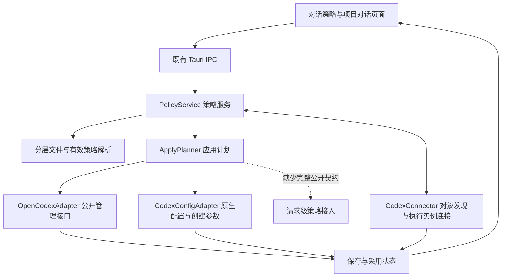
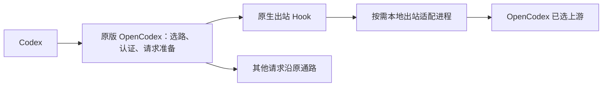

# 对话策略执行架构与 OpenCodex 扩展边界
2026-10-28 受限真实确认已通过：FeiMao/gpt-6.1-sol 经现有 OpenCodex 2.84.0 路由返回合成 PROBE_OK，同一路由的 web_search 访问 example.com 成功。该证据只覆盖一个模型 / 代理路线和合成输入，未扩大为全部渠道或模型。
2026-10-28 目标模式验证已继续：独立 owning app-server 的双客户端控制通过；当前活动 App 的 stdio 启动无法外部接入；OpenCodex 插件加载和出站转发通过，但 API-key 出站没有 thread / subagent 身份；两个项目、三个并发父 thread 的原生 child 默认、同项目对话覆盖、显式覆盖与新全局默认均通过；真实引擎经 OpenCodex 手动压缩后续聊也通过。后台阈值前提纠正后，已在明确远程 v2 的隔离链路观察非阻塞后台摘要；客户端流程对照未启用后台。完整证据见[分层验证计划](../../03-测试验收/20261027-对话策略分层可行性验证计划.md#6-2026-10-28-目标模式验证结果)。

日期：2026-10-27，Asia/Shanghai。状态：基于源码与既有隔离结果的架构提案；生产开发、版本和时机未定。本轮不修改原版 OpenCodex、不改变日常配置、不启动新代理或调用模型。

后续用户询问如何验证，已补[分层可行性验证计划](../../03-测试验收/20261027-对话策略分层可行性验证计划.md)，并用当前 Codex 0.164.0-alpha.11.1 重新执行原生隔离探针，8 项通过。该复跑仅本地 Responses 替身，不证明当前 App 连接、局部 sidecar / child 或真实渠道已接通。

关联：[原对话执行方案](../../../2026-10-11-Codex对话配置管理/01-需求分析/02-方案草案/Codex对话配置与实时生效方案.md)、[分层存储方案](../../../2026-10-11-Codex对话配置管理/01-需求分析/02-方案草案/独立配置存储与事件订阅适配方案.md)、[当前页面](../../../../../01-项目支撑资料/01-产品原型/对话策略页面与Superba参考.md)。

## 1. 结论

采用 **Desktop 策略管理 + 原生配置 / 执行适配 + 按需出站插件**。OpenCodex 继续负责现有渠道选择、认证、协议处理和故障切换；配置能落盘、执行端能读取、请求实际采用分别判断。

当前已有方案覆盖存储、继承、页面和候选出站位置，本次补上具体执行组件、插件接入事实及其限制。全局原生能力可以先实施；外部已运行 Codex App 的项目 / 对话自动策略、第三方原生压缩和 history/notes 仍有执行接入缺口。不能将原型可选项统称为“都能靠配置实现”。

用户此前明确只做外部管理层，保持原版安装与更新完整；本轮没有改变这一边界。前置分流完整会话仍未采用，不为补缺口默认引入第二套渠道路由。

## 2. 架构分工

| 组成 | 职责 | 不能混入的责任 |
| --- | --- | --- |
| PolicyStore | 全局新增意图、按项目文件、按需对话文件、revision 与来源引用 | 正文、凭据、模型目录副本；OpenCodex 已有全局字段不另建可改镜像 |
| PolicyResolver | 解析本项目全局 → 项目 → 对话覆盖，输出逐字段来源及期望值 | 不能假定此优先级自动覆盖原生角色或权限 |
| ApplyPlanner | 每字段确定目标适配器、允许参数、真正生效节点与未应用原因 | 不给整页统一“立即”或“重启”结论，不轮流改全局文件模拟局部配置 |
| OpenCodexAdapter | 公开 CLI / API 的全局搜索、helper、子 Agent、传输等配置 | 复用运行实例绑定与管理请求机制；不私改其内部配置、安装或生成目录 |
| CodexConfigAdapter | 通过获授权的公开配置入口管理用户级字段，或为受控的新建 / resume 任务传入支持的 config | 不把持久参数包装成仅本轮，也不保证已加载外部会话自动重载 |
| CodexConnector | 分页项目 / thread、归档、标题、父子关系，以及实际 owning 实例连接 | 持久记录可读不等于运行中的任务可控 |
| ObservedState | 保存修订、装载 / 接收及最终模型 / 路径分别呈现 | 没有记录保持未观察，不凭握手或重启声称请求已采用 |

生产建议沿既有 Rust 模块新增 modules/dialog_policy 与 modules/codex_connector；前端在 features/dialog-policy、features/conversations 组合。复用 model_config 的模型身份、官方管理连接、受控写入、备份和事件底座，不把全部逻辑塞进模型模版模块。上述目录为候选，不是已创建实现。

配置保存发布事件，失效相关解析缓存；进入页面、恢复前台、连接恢复及手动刷新时补拉。按需文件读取与有界索引足够，不新增每项目一个轮询器。跨来源保存分别报告结果，不包装成已有跨文件事务。WebDAV 仍默认排除本包配置，历史仅显式本地恢复；本次不扩大同步载荷。

## 3. 原版已经有可用的出站插件入口

本机 @bitkyc08/opencodex 2.84.0 的 src/plugins/loader.ts 定义：ocx start 在监听前加载 OPENCODEX_HOME/plugins 下的 ts/js/mjs 模块；插件导出 setup(ctx)，通过 ctx.registerUpstreamRewriter 注册同步回调。GitHub 默认分支已读片段与本机相同契约，尚不代表跨版本稳定承诺。

回调的 UpstreamTarget 只有 **url、headers、transport**。物理 HTTP 发送和已选中的 Codex WS dial 使用该入口。

因此既有“OpenCodex 选路后出站增强”有具体接入候选，无需修改安装包或导入内部模块。Hook 可以改 URL 和头，把已选目标导向本地 sidecar；sidecar 从正常请求取得正文，按明确配置处理，响应状态、必要头与流沿原链路返回。是否保留取消、超时、错误与计费归属须另外验证。

这不是普通全局配置的必选依赖；没有具体用途时不先建一个通用代理。若引入 sidecar，应由后台生命周期管理，不能依赖设置窗口打开。同步 Hook 只读取轻量快照，不阻塞 I/O、不调用模型、不临时改配置。插件代码首次加载需要 OpenCodex 进程重新启动；插件自身策略快照是否热更新另行实现。

### 出站 Hook 的实际限制

1. 没有 body、providerId、request purpose 或完整可信的 project / thread / turn 上下文；相同 URL 也不能唯一标识不同账号和 Provider。
2. Hook 在路由和 HTTP / WS 选择后执行；改地址不能重新选择原生协议，也不能把原本 HTTP 的第三方路径自动变成完整原生 WS。
3. API-key Responses 模式的额外 caller-header 白名单只有少量指纹字段，thread-id / parent / subagent 标记不在其中；forward 模式的完整转发头不能推广到 key 模式。x-client-request-id 也不自动等于 threadId。
4. 不能补出模型目录已删除的实验上下文声明，不能收到出口前已拒绝的 history/notes，不能将已经变成摘要的压缩请求可靠还原为 native 协议。
5. Hook 没有响应完成 / 最终采用回调。sidecar 自身观察也不自动成为 OpenCodex 的完整日志或产品采用证据。
6. 此版本在 Windows 禁用插件自动加载；macOS 的源码入口存在不等于已完成跨平台验证。

插件抛错时，当前实现回滚本次改写、禁用该 rewriter 并继续原通路；不据此推断 sidecar 失联时也会同样回退。已经涉及不可互换的压缩状态或笔记写入时，不擅自换目的地重试。

## 4. 每项能力接在哪里

| 功能 | 首选路径 | 现有可行性与缺口 |
| --- | --- | --- |
| 全局命名模型 | OpenCodex helper / shadow-call 原生设置 | 现有规则按源模型匹配，还可能影响提交信息等 helper；尚不能承诺只影响标题，不能悄悄扩大原型语义 |
| 按当前内容重新命名 | 读取目标内容 → 全局模型生成候选 → 用户采用 → thread/name/set | 可按显式一次操作设计；标题接口不证明已连接当前 App 的刷新与生成服务 |
| 全局搜索模型 | 原版 sidecar 管理 API | 后续 plan 构建读取；hosted search、Exa 等分路径，不能统称全部搜索模型被替换 |
| 全局子 Agent | 原版 / Codex 默认、推荐、角色、指令、并发各自接口 | 推荐不是强制；装载点与 V1/V2 分别验证；改模型字段不能替代任务创建与权限控制 |
| 项目 / 对话搜索 | 搜索 plan 前的 request-local 配置 | 出站 Hook 太晚，不能改已经构建的 plan；目前缺少这一完整公开执行契约 |
| 项目 / 对话子 Agent | owning 引擎的创建参数与受支持配置层 | 原生 defaults 已通过创建时 config 投影的并发实测；所测 loaded thread 的同实例 resume 不应用新 child defaults，不能承诺热更新，角色仍可再次覆盖模型 / effort |
| 常规 / 后台压缩 | Codex 原生功能和阈值，沿原 OpenCodex 支持路径 | 手动压缩后续聊及远程 v2 下非阻塞后台调度均有隔离证据；客户端流程不满足后台启用条件，代理摘要仍如实标成摘要 |
| 第三方原生远程压缩 | 完整保留 native 协议与状态的原生路径 | routed 请求目前先转摘要，出口层不足以补齐，依赖原版公开支持 |
| 历史与笔记 | 目录声明 + 正文 / 历史 / 笔记一致服务身份 | 当前第三方目录和入口均有限制；配置文件、重启或出口插件都不足以打通 |
| WebSocket | 统一管理客户端声明与本地入口，上游遵循原版条件 | 入口和上游两段分别观察；不承诺任意第三方端到端 WS |
| 推理 / Fast | 共用组件产生明确选择，交给已有模型参数与原版规则 | 选择成功、实际序列化、上游授予分别判断，不另建一套速度开关 |

## 5. 项目、对话与子任务的关键身份

项目策略按 sourceId + 原生 projectId，单对话按 sourceId + threadId 绑定；名称和 cwd 仅显示 / 候选匹配。当前公开协议的 Project.id/roots 与 Thread.projectId/cwd 分开存在，不能把目录分组当原生项目；sessionId 可以为线程树共享，不替代每个 child 的 threadId。

原生项目配置按可信 cwd 的 .codex/config.toml 等层装载，并非按本项目文件夹里的 projectId 自动加载。本项目按原生 ID 的独立配置仍应保存在管理器活动数据根；需要通过执行适配器显式投影，不能为了省接入偷偷写进用户项目仓库。

原生支持 agents.default_subagent_model、agents.default_subagent_reasoning_effort。已读 child 创建逻辑先处理显式 spawn 值、默认值与父值，再应用角色配置；角色可能再次覆盖 model / effort。**原草案“角色默认始终低于项目 / thread 显式选择”的规则不能当作现有原生行为。**本项目解析出的期望值与原生最终采用必须分别解释，第一阶段尊重已存在的角色优先级，不靠额外请求重写强行模拟另一套规则。

thread/start/resume 有通用 config 参数；当前 settings/update 没有 child 默认专用或通用 config 更新字段。2026-10-28 实测同一已加载父 thread 的 resume 接受新默认 config，却仍以旧默认创建 child；不能据通用参数存在就宣称该入口热更新成功。turn/start 的 model / effort 会持续到后续轮次，既不是 child 专用默认，也不是仅一轮覆盖。因此完整项目 / 对话子 Agent 配置优先在任务装载 / 创建时进入 owning 引擎；不能承诺现有会话中途立即更新。

共享 CODEX_HOME 的第二个 app-server 能读持久线程，不能直接控制第一个进程已加载的同一线程。前序隔离实测已记录 thread not found；本轮没有证明当前桌面 App 是否公开外部连接端点。Desktop 若只控制自己创建的新引擎，就只能承诺这些受控任务的范围。

## 6. 局部策略需要的执行契约

若要让已经运行的外部 Codex App 自动采用局部配置，需要 owning 引擎的公开任务控制，或 OpenCodex 在选路 / 搜索 plan 前提供公开 request-local 策略接入。下述是所需契约，不是已有 API：

~~~text
resolvePolicy({ sourceId, projectId, threadId, parentThreadId,
                rootThreadId, turnId?, purpose, explicitOverrides })
  -> { revision, effectiveFields, fieldOrigins, supportedEffects }
~~~

purpose 由真实调用节点提供，例如 main、subagent、title、search、compaction、history，不解析提示词猜用途。每次执行使用独立配置副本；可以取得父 turn 边界时，在起点生成快照，child 继承该快照再应用显式参数和原生角色规则。只有 HTTP 边界时就如实承诺下一请求，不伪称整轮 / Agent 树一致。

缺少身份时继续既有原生行为并报告局部策略未匹配，不按路径文本、请求先后、同名模型猜测归属。原型可以保留策略意图，但不能标为已采用。

## 7. 实施顺序

1. **先接原生全局闭环**：全局搜索、明确边界的子 Agent 默认、上下文基础与连接；验证读回、装载、采用。自动命名先解决标题专用识别，不能用 broad helper 代替而不说明。
2. **优先验证身份与局部执行**：两个项目同时用不同搜索模型，一个父对话创建两个 child，核对 ID / purpose / revision，撤销覆盖后恢复真实有效值。先证明执行接入，再扩展只会落盘的局部字段。
3. **按实际用途引入出站层**：插件加载、固定目的地转发、流、取消、错误、WS、平台和后台生命周期分别验证。已有配置即可完成的字段不经过额外进程。
4. **原生上下文独立演进**：推动或等待上游第三方 native compact / history / notes 公开支持，不阻塞前几项。若将来讨论完整前置通路，应作为架构范围变化，不在本轮顺带实施。

这是逐项实施顺序，不要求所有能力齐备才能开始，也不增加层层审批。沿既有受控保存、事件、备份与按源恢复，验证重点是配置命中正确对象、并发不串项目、原通路继续可用。

## 8. 来源与本轮最小验证

OpenCodex 基线是本机安装包 2.84.0，根为 /Users/ezio/Library/Application Support/com.gzers.opencodex.desktop/runtime/opencodex/node_modules/@bitkyc08/opencodex；不自动等于当前运行服务。Codex 本机 CLI 当前为 0.164.0-alpha.11.1；前序 native probe 是 0.162.0-alpha.2，两者结果不混算。

| 来源 | 支持的结论 |
| --- | --- |
| OpenCodex src/plugins/loader.ts:4、32、270、327；src/cli/index.ts:561 | setup 接口、启动加载、Windows 禁用与注册 |
| src/plugins/upstream-hooks.ts:16、52；src/server/responses/fetch-helpers.ts:160 | 三字段出站契约、异常回滚、HTTP 改写位置 |
| src/server/responses/ws-upstream.ts:93、123 | WS dial 改写与原生资格选择分开 |
| src/lib/provider-client-headers.ts:27；src/adapters/openai-responses/passthrough.ts:70、101、275 | forward 与 key 模式的身份头差异 |
| src/server/context-history.ts:100；src/codex/catalog/parsing.ts:857 | 第三方 history 入口与目录限制 |
| src/server/responses/response-effects.ts:68；src/types/config.ts:811 | routed 压缩摘要、helper 非标题专用 |
| [Codex 项目结构](https://github.com/openai/codex/blob/main/codex-rs/app-server-protocol/src/protocol/v2/project.rs#L15)、[线程身份](https://github.com/openai/codex/blob/main/codex-rs/app-server-protocol/src/protocol/v2/thread_data.rs#L205) | 原生 projectId 与 cwd、thread 与 parent / session 分开 |
| [官方配置 Schema](https://learn.chatgpt.com/docs/config-schema.json)、[子 Agent 配置](https://learn.chatgpt.com/docs/agent-configuration/subagents#custom-agents) | defaults 及角色优先级 |
| [固定 child 创建实现](https://github.com/openai/codex/blob/eec8bde1e9a5fe0e6cbefa88ff587ad1a478c08a/codex-rs/core/src/agent/child_config.rs#L51) | 创建装载顺序；不是外部插件 API |
| [线程 start/resume 参数](https://github.com/openai/codex/blob/main/codex-rs/app-server-protocol/src/protocol/v2/thread.rs#L236)、[turn 参数持续性](https://github.com/openai/codex/blob/main/codex-rs/app-server-protocol/src/protocol/v2/turn.rs#L255) | config 与持续模型覆盖的不同 |
| [官方 app-server](https://learn.chatgpt.com/docs/app-server#protocol)、前序 .adg/evidence/COL-LOCAL-20261011-01/native-probe-20261011.json | 公开连接类型与已有双实例隔离结果；不证明当前 App 可连接 |

在线只读复核了[插件上下文](https://github.com/lidge-jun/opencodex/blob/main/src/plugins/loader.ts#L32)、[出站契约](https://github.com/lidge-jun/opencodex/blob/main/src/plugins/upstream-hooks.ts#L16)。main 链接可变，不作为固定发布保证；本机源指纹随探针记录。

新增[纯源码契约探针](../../../../../../../test/architecture-probes/20261027-opencodex-extension-contract.mjs)，Node 26 只在内存去掉两份无导入源模块的 TS 类型，6 项通过：无插件原目标、三字段上下文 / 不污染原头、并发请求隔离、抛错回滚及停用、WS loopback 处理、key 模式身份白名单限制。不加载生产插件、不读取凭据 / 配置、不起服务、不发网络，不证明真实 sidecar 或完整 App 接入可用。

复跑：node test/architecture-probes/20261027-opencodex-extension-contract.mjs [opencodex包绝对路径]。stripTypeScriptTypes 是测试工具的实验接口，不进入产品运行依赖。
